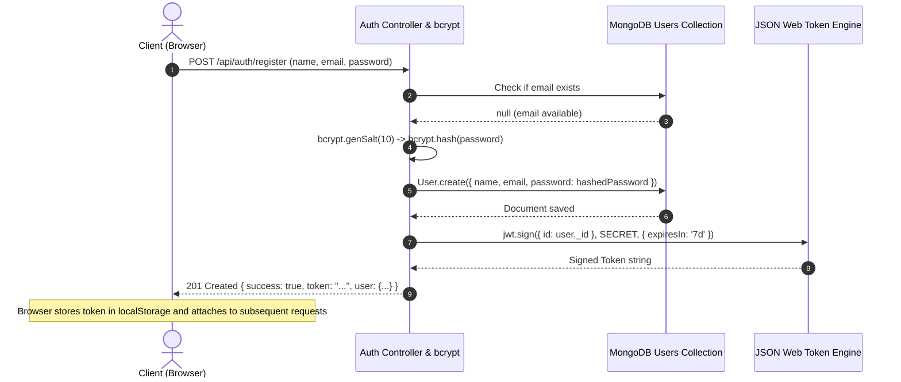

# MODEL LAB MASTER MANUAL & PRACTICAL LEARNING HANDBOOK
# WEB TECHNOLOGIES & FULL-STACK LABORATORY

> **Central Reference Application:** CampusConnect — Student Project Management Portal  
> **Target Frameworks & Tools:** Figma, HTML5, CSS3, JavaScript (ES6+), AngularJS 1.8.2, Node.js (LTS), Express.js 4.x, MongoDB 6.x/7.x & Mongoose 7.x, Selenium WebDriver 4.x (Python / pytest), XML, DTD, XSLT 1.0, XPath 1.0, XQuery 1.0/3.0.  
> **Operating Environments:** Windows PowerShell (Primary) and Ubuntu/Debian Linux (Cross-platform reference).  

---

## TABLE OF CONTENTS
1. [PART A — System Architecture, Fundamentals & Environment Setup](#part-a--system-architecture-fundamentals--environment-setup)
2. [PART B — Figma UI/UX Design Specification & Wireframes](#part-b--figma-uiux-design-specification--wireframes)
3. [PART C — AngularJS 1.x Frontend Engineering & Styling](#part-c--angularjs-1x-frontend-engineering--styling)
4. [PART D — Node.js, Express.js & RESTful Backend Architecture](#part-d--nodejs-expressjs--restful-backend-architecture)
5. [PART E — Complete CRUD Operations (Lifecycle & Negative Testing)](#part-e--complete-crud-operations-lifecycle--negative-testing)
6. [PART F — Authentication, Security & Application Integration](#part-f--authentication-security--application-integration)
7. [PART G — Selenium WebDriver Test Automation Suite (12 Variants)](#part-g--selenium-webdriver-test-automation-suite-12-variants)
8. [PART H — XML Fundamentals, Well-Formedness & Namespaces](#part-h--xml-fundamentals-well-formedness--namespaces)
9. [PART I — DTD (Document Type Definition) All Required Variants](#part-i--dtd-document-type-definition-all-required-variants)
10. [PART J — XSLT: Extensible Stylesheet Language Transformations](#part-j--xslt-extensible-stylesheet-language-transformations)
11. [PART K — XPath: XML Navigation and Queries](#part-k--xpath-xml-navigation-and-queries)
12. [PART L — XQuery: XML Data Querying & FLWOR Expressions](#part-l--xquery-xml-data-querying--flwor-expressions)
13. [PART M — XML Processors, Validators, Formatters & Serializers](#part-m--xml-processors-validators-formatters--serializers)
14. [PART N — Complete Frontend-Backend Integration Workflow](#part-n--complete-frontend-backend-integration-workflow)
15. [PART O — Diagnostic & Troubleshooting Handbook (Windows PowerShell First)](#part-o--diagnostic--troubleshooting-handbook-windows-powershell-first)
16. [PART P — 20 Practical Exam Experiments (Complete Program, Output & Viva)](#part-p--20-practical-exam-experiments)
17. [PART Q — Comprehensive Viva Voce Question Bank (50+ Categorized Q&A)](#part-q--comprehensive-viva-voce-question-bank)
18. [PART R — Last-Minute Revision & Problem Statement Adaptation Guide](#part-r--last-minute-revision--problem-statement-adaptation-guide)

---

# PART A — SYSTEM ARCHITECTURE, FUNDAMENTALS & ENVIRONMENT SETUP

## 1. High-Level Full-Stack Architecture

The application implements a 3-tier decoupled architecture:
1. **Client Tier (Presentation):** Single Page Application (SPA) powered by AngularJS 1.8.2, HTML5 semantic structure, and responsive CSS3. It communicates asynchronously via HTTP/HTTPS with JSON payloads.
2. **Server Tier (Application Logic):** Stateless RESTful API running on Node.js using the Express.js micro-framework. It handles authentication, request validation, business rules, authorization, and error formatting.
3. **Database Tier (Persistence):** Document-oriented NoSQL database MongoDB, interfaced through Mongoose Object Data Modeling (ODM).

```mermaid
sequenceDiagram
    autonumber
    actor User as Student / Evaluator
    participant Browser as Browser (AngularJS 1.8.2 SPA)
    participant Express as Node.js / Express.js Server (:3000)
    participant Auth as Auth Middleware (JWT)
    participant Mongo as MongoDB Server (:27017)

    User->>Browser: Submits "Create Project" form
    Browser->>Browser: Client-side Validation (AngularJS Form & CSS)
    Browser->>Express: POST /api/projects (Headers: Bearer <token>, Body: JSON)
    Express->>Auth: Verify JWT Token in Authorization header
    alt Token Invalid or Expired
        Auth-->>Browser: 401 Unauthorized { success: false, message: "Token expired" }
    else Token Valid
        Auth->>Express: Attach req.user = { id, email, role }
        Express->>Express: Validate Schema Rules (Mongoose schema)
        Express->>Mongo: Project.create({ title, desc, tech, status, owner })
        Mongo-->>Express: Returns Saved Document with _id and timestamps
        Express-->>Browser: 201 Created { success: true, project: {...} }
        Browser->>Browser: Update projects array; display alert banner
        Browser-->>User: Project visible in table & card views
    end
```

## 2. Technology Responsibility Matrix

| Technology | Architectural Layer | Primary Responsibility | Common Mistake to Avoid |
| :--- | :--- | :--- | :--- |
| **Figma** | UX/UI Prototyping | Wireframing, color systems, component hierarchy, click-through flow. | Assuming Figma automatically generates a production backend database. |
| **HTML5 & CSS3** | Client Presentation | Semantic layout structure, accessibility attributes, visual aesthetics, responsive grid/flexbox. | Using inline styles (`style="..."`) instead of modular utility CSS classes. |
| **AngularJS 1.8.2** | Client Logic (SPA) | Two-way data binding (`ng-model`), view routing (`ngRoute`), declarative directives, HTTP client (`$http`). | Confusing AngularJS 1.x (`$scope`, `angular.module`) with Angular 2+ (TypeScript, decorators). |
| **Node.js** | Server Runtime | Non-blocking asynchronous I/O JavaScript runtime executing server scripts outside the browser. | Treating Node.js as a framework rather than an execution engine. |
| **Express.js** | Web Framework | Routing HTTP verbs (GET, POST, PUT, DELETE), middleware chains, CORS, JSON parsing. | Mixing routing logic with database schema definitions in a single unmaintained file. |
| **MongoDB & Mongoose** | Data Persistence | Storing schemaless BSON documents, enforcing ODM validation schemas, indexing, querying. | Hardcoding database passwords or database names inside client-side JavaScript. |
| **Selenium WebDriver** | Test Automation | Automating real browser actions (Chrome/Edge), verifying DOM elements, validating user journeys. | Using arbitrary long sleeps (`time.sleep(10)`) instead of dynamic explicit waits (`WebDriverWait`). |
| **XML / DTD / XSLT / XPath / XQuery** | Data Modeling & Interchange | XML data documents, DTD validation grammar, XSLT stylesheet transformation to HTML, XPath node navigation, XQuery FLWOR queries. | Confusing AngularJS date/currency filters with XML formatters/processors. |

## 3. Core Web Concepts & HTTP Essentials

### Client-Server Model & REST
- **Client:** Requests resources or triggers mutations by transmitting HTTP requests containing Method, URI, Headers, and optional Body.
- **Server:** Listens on a dedicated network port, validates request parameters, executes business rules, and returns an HTTP response containing Status Code, Headers, and Data payload (JSON/HTML/XML).
- **Statelessness:** In REST (Representational State Transfer), the server stores no client session context between requests. Each client request must supply all context needed to execute (e.g., Bearer JWT token in headers).

### HTTP Methods (Verbs)
- `GET`: Safe and idempotent. Retrieves records. Never alters server state.
- `POST`: Non-idempotent. Submits new data to create a new resource. Returns `201 Created`.
- `PUT`: Idempotent. Completely replaces an existing resource with the supplied body.
- `PATCH`: Partially modifies specific fields of an existing resource without replacing the entire entity.
- `DELETE`: Idempotent. Removes the specified resource. Returns `200 OK` or `204 No Content`.

### HTTP Status Codes
- `200 OK`: Successful retrieval or update.
- `201 Created`: Resource successfully created (used for POST).
- `400 Bad Request`: Validation failure or malformed JSON payload from the client.
- `401 Unauthorized`: Missing, invalid, or expired authentication token.
- `403 Forbidden`: Authenticated user lacks permission to modify another user's resource.
- `404 Not Found`: Resource or endpoint does not exist.
- `409 Conflict`: Duplicate key error (e.g., email address already registered).
- `500 Internal Server Error`: Unhandled backend exception or database downtime.

## 4. Environment Verification & Installation Commands

### Windows PowerShell Verification Commands
Run these commands in PowerShell to inspect available runtimes:
```powershell
# 1. Verify Node.js and npm
node --version
npm --version

# 2. Verify Python and package manager
python --version
pip --version

# 3. Check MongoDB service status on Windows
Get-Service -Name *MongoDB* -ErrorAction SilentlyContinue

# 4. Check whether MongoDB port 27017 is actively listening
Test-NetConnection -ComputerName localhost -Port 27017

# 5. Check Git version
git --version

# 6. Check web browser executables (Chrome and Edge)
Get-Item "C:\Program Files\Google\Chrome\Application\chrome.exe", `
         "C:\Program Files (x86)\Microsoft\Edge\Application\msedge.exe" `
         -ErrorAction SilentlyContinue | Select-Object FullName
```

### Ubuntu / Debian Linux Alternative Commands
```bash
# 1. Update package list & install essentials
sudo apt update
sudo apt install -y curl wget git python3 python3-pip python3-venv

# 2. Check Node.js and npm (install via NodeSource if missing)
node -v
npm -v

# 3. Check MongoDB service status on Linux
sudo systemctl status mongod --no-pager
# Start MongoDB if stopped:
sudo systemctl start mongod

# 4. Check listening port
ss -tulpn | grep 27017
```

---

# PART B — FIGMA UI/UX DESIGN SPECIFICATION & WIREFRAMES

## 1. Design System & Tokens
- **Target Audience:** College students, faculty mentors, and academic evaluators.
- **Visual Aesthetic:** Clean, modern, accessible light theme with high contrast, calm primary accents, and distinct status color tags.

| Token | Name | Hex Code | Usage |
| :--- | :--- | :--- | :--- |
| `--bg-main` | Canvas Background | `#F8FAFC` | Main application background (slate-50). |
| `--surface-card` | Card Surface | `#FFFFFF` | Card containers, modal sheets, table rows. |
| `--primary` | Royal Blue | `#2563EB` | Primary CTA buttons, active sidebar tabs, brand headers. |
| `--primary-hover`| Deep Blue | `#1D4ED8` | Hover state for primary buttons. |
| `--text-main` | Slate 900 | `#0F172A` | Primary headings, titles, high-emphasis text. |
| `--text-muted` | Slate 500 | `#64748B` | Subheadings, timestamps, secondary labels. |
| `--border-color`| Slate 200 | `#E2E8F0` | Dividers, card borders, input borders. |
| `--status-not` | Amber (Not Started) | `#D97706` | Warning badges for unstarted tasks. |
| `--status-prog`| Indigo (In Progress)| `#4F46E5` | Active progress indicator badges. |
| `--status-done`| Emerald (Completed) | `#059669` | Success badges for completed projects. |
| `--danger` | Rose Red | `#DC2626` | Delete buttons, validation error banners. |

## 2. Spacing & Typography Rules
- **Font Family:** `'Inter', -apple-system, BlinkMacSystemFont, 'Segoe UI', Roboto, sans-serif`.
- **Scale:**
  - H1 Page Title: `28px` / Line Height `36px` / Semi-Bold (`600`)
  - H2 Section Header: `20px` / Line Height `28px` / Medium (`500`)
  - Body Text: `14px` / Line Height `20px` / Regular (`400`)
  - Small / Badge Text: `12px` / Line Height `16px` / Medium (`500`)
- **Spacing Grid:** 8pt incremental grid (`8px`, `16px`, `24px`, `32px`, `48px`).

## 3. Screen Wireframes & Component Specs

### Screen 1: Welcome & Landing Screen (Desktop 1440x900)
```text
+------------------------------------------------------------------------------------+
|  [Logo] CampusConnect               [About]  [Features]     [Login]  [Register]    |
+------------------------------------------------------------------------------------+
|                                                                                    |
|       Streamline Your Academic Project Lifecycle                                    |
|       Centralized repository for student proposals, team tracking, and evaluations. |
|                                                                                    |
|       [ Get Started -> (Register) ]        [ View Demo / Login ]                    |
|                                                                                    |
|  +-----------------------+ +-----------------------+ +-----------------------+     |
|  | [Icon] Team Sync      | | [Icon] Status Board   | | [Icon] Grade Tracking |     |
|  | Real-time assignment  | | Kanban-style progress | | Faculty assessment    |     |
|  +-----------------------+ +-----------------------+ +-----------------------+     |
+------------------------------------------------------------------------------------+
```

### Screen 2: Authentication Modal / Login Screen (Frame: 480x560 centered)
```text
+-------------------------------------------------------------+
|                     CampusConnect Portal                    |
|                     Sign in to your account                 |
+-------------------------------------------------------------+
|  Email Address                                              |
|  [ student@college.edu                                    ] |
|                                                             |
|  Password                                                   |
|  [ ****************                                       ] |
|                                                             |
|  [x] Remember me                      [Forgot Password?]    |
|                                                             |
|  +-------------------------------------------------------+  |
|  |                  [ Sign In Button ]                   |  |
|  +-------------------------------------------------------+  |
|                                                             |
|  Don't have an account? [Create an account ->]              |
+-------------------------------------------------------------+
```

### Screen 3: Project Management Dashboard (Main App Shell)
```text
+-------------+----------------------------------------------------------------------+
| [CampusCon] | [Search projects...]              [Sort: Newest v]  [User: Alex v]   |
+-------------+----------------------------------------------------------------------+
| [Dashboard] | PROJECT DASHBOARD                                   [+ New Project]  |
| [Projects ] | Quick Stats: Total: 12 | In Progress: 5 | Completed: 6 | Pending: 1  |
| [Teams    ] |----------------------------------------------------------------------|
| [Settings ] | Filter Status: [ All ]  [ Not Started ]  [ In Progress ]  [ Completed] |
| [Logout   ] |----------------------------------------------------------------------|
|             | +--------------------+ +--------------------+ +--------------------+ |
|             | | Smart Attendance   | | Campus Food App    | | AI Notes Summarizer| |
|             | | Python, OpenCV     | | Node, Angular, DB  | | Python, PyTorch    | |
|             | | Status: [Completed]| | Status:[In Progress]| | Status:[Not Start] | |
|             | | Owner: Alex P.     | | Owner: Sara K.     | | Owner: John M.     | |
|             | | [View] [Edit] [Del]| | [View] [Edit] [Del]| | [View] [Edit] [Del]| |
|             | +--------------------+ +--------------------+ +--------------------+ |
+-------------+----------------------------------------------------------------------+
```

### Screen 4: Add / Edit Project Form Modal (Frame: 640x720)
```text
+--------------------------------------------------------------------+
| Add New Student Project                                        [X] |
+--------------------------------------------------------------------+
| Project Title *                                                    |
| [ Enter project title (min 5 characters)                         ] |
|                                                                    |
| Technology Stack * (comma-separated)                               |
| [ AngularJS, Express.js, MongoDB                                 ] |
|                                                                    |
| Team Members * (comma-separated names)                             |
| [ Alex Patel, Priya Sharma, Dev Kumar                            ] |
|                                                                    |
| Project Status *                                                   |
| ( ) Not Started        (*) In Progress        ( ) Completed        |
|                                                                    |
| Description *                                                      |
| [ Detailed abstract of project goals, methodology, and tech...   ] |
| [                                                                ] |
|                                                                    |
| [ Cancel ]                                 [ Save Project Record ] |
+--------------------------------------------------------------------+
```

## 4. Figma to Code Mapping Reference
- **Figma Auto Layout (Horizontal)** maps directly to CSS `display: flex; flex-direction: row; gap: 16px;`.
- **Figma Auto Layout (Vertical)** maps directly to CSS `display: flex; flex-direction: column; gap: 12px;`.
- **Figma Component Variants (Primary, Danger, Outline)** map to `.btn.btn-primary`, `.btn.btn-danger`, `.btn.btn-outline`.
- **Figma Color Tokens** map to CSS Custom Properties `:root { --primary: #2563EB; ... }`.

---

# PART C — ANGULARJS 1.x FRONTEND ENGINEERING & STYLING

## 1. Directory Structure of Frontend
```text
frontend/
├── index.html                  # Main SPA entry point shell
├── css/
│   └── styles.css              # Modern accessible CSS styling & animations
└── js/
    ├── app.js                  # Module declaration, routes, and config
    ├── controllers/
    │   ├── AuthController.js   # Login and registration logic
    │   ├── DashboardCtrl.js    # Statistics and overview logic
    │   └── ProjectCtrl.js      # CRUD operations, search, sort, filter
    ├── services/
    │   ├── AuthService.js      # JWT token storage and login API calls
    │   └── ProjectService.js   # $http calls for project CRUD endpoints
    ├── directives/
    │   └── projectCard.js      # Reusable project card directive
    ├── filters/
    │   └── techBadgeFilter.js  # Custom filter to format tech stack tags
    └── views/
        ├── login.html          # Login view partial
        ├── register.html       # Register view partial
        ├── dashboard.html      # Main dashboard with project list
        ├── project-form.html   # Add/Edit form view
        └── project-details.html# Detailed single project view
```

## 2. Complete Modern Responsive CSS (`frontend/css/styles.css`)
```css
/* ==========================================================================
   CampusConnect - Modern Light Theme Stylesheet
   Compatible with AngularJS 1.8.2 and ngAnimate
   ========================================================================== */

:root {
  --bg-main: #f8fafc;
  --surface-card: #ffffff;
  --primary: #2563eb;
  --primary-hover: #1d4ed8;
  --text-main: #0f172a;
  --text-muted: #64748b;
  --border-color: #e2e8f0;
  --status-not-bg: #fef3c7;
  --status-not-text: #92400e;
  --status-prog-bg: #e0e7ff;
  --status-prog-text: #3730a3;
  --status-done-bg: #d1fae5;
  --status-done-text: #065f46;
  --danger: #dc2626;
  --danger-hover: #b91c1c;
  --radius-sm: 6px;
  --radius-md: 10px;
  --radius-lg: 16px;
  --shadow-sm: 0 1px 3px rgba(0, 0, 0, 0.05);
  --shadow-md: 0 4px 6px -1px rgba(0, 0, 0, 0.08), 0 2px 4px -1px rgba(0, 0, 0, 0.04);
  --shadow-lg: 0 10px 15px -3px rgba(0, 0, 0, 0.08);
  --transition-fast: all 0.2s cubic-bezier(0.4, 0, 0.2, 1);
}

/* Prevent AngularJS raw expressions flashing on page load */
[ng\:cloak], [ng-cloak], [data-ng-cloak], [x-ng-cloak], .ng-cloak, .x-ng-cloak {
  display: none !important;
}

* {
  box-sizing: border-box;
  margin: 0;
  padding: 0;
}

body {
  font-family: 'Inter', -apple-system, BlinkMacSystemFont, 'Segoe UI', Roboto, sans-serif;
  background-color: var(--bg-main);
  color: var(--text-main);
  line-height: 1.5;
  font-size: 14px;
  min-height: 100vh;
}

/* Layout Container */
.app-layout {
  display: flex;
  min-height: 100vh;
}

/* Sidebar Navigation */
.app-sidebar {
  width: 250px;
  background-color: var(--surface-card);
  border-right: 1px solid var(--border-color);
  display: flex;
  flex-direction: column;
  padding: 24px 16px;
}

.brand-header {
  display: flex;
  align-items: center;
  gap: 12px;
  padding-bottom: 24px;
  border-bottom: 1px solid var(--border-color);
  margin-bottom: 24px;
}

.brand-logo {
  width: 36px;
  height: 36px;
  background: var(--primary);
  color: #fff;
  font-weight: 700;
  font-size: 18px;
  border-radius: var(--radius-sm);
  display: flex;
  align-items: center;
  justify-content: center;
}

.brand-title {
  font-size: 18px;
  font-weight: 700;
  color: var(--text-main);
}

.nav-links {
  list-style: none;
  display: flex;
  flex-direction: column;
  gap: 6px;
  flex-grow: 1;
}

.nav-item a {
  display: flex;
  align-items: center;
  gap: 12px;
  padding: 10px 14px;
  color: var(--text-muted);
  text-decoration: none;
  border-radius: var(--radius-sm);
  font-weight: 500;
  transition: var(--transition-fast);
}

.nav-item a:hover {
  background-color: #f1f5f9;
  color: var(--primary);
}

.nav-item.active a {
  background-color: #eff6ff;
  color: var(--primary);
  font-weight: 600;
}

/* Main Content Area */
.app-main {
  flex-grow: 1;
  display: flex;
  flex-direction: column;
  background-color: var(--bg-main);
}

.app-navbar {
  height: 64px;
  background-color: var(--surface-card);
  border-bottom: 1px solid var(--border-color);
  display: flex;
  align-items: center;
  justify-content: space-between;
  padding: 0 32px;
}

.app-container {
  padding: 32px;
  max-width: 1200px;
  margin: 0 auto;
  width: 100%;
}

/* Typography & Titles */
.page-title {
  font-size: 24px;
  font-weight: 700;
  color: var(--text-main);
  margin-bottom: 8px;
}

.page-subtitle {
  font-size: 14px;
  color: var(--text-muted);
  margin-bottom: 24px;
}

/* Buttons */
.btn {
  display: inline-flex;
  align-items: center;
  justify-content: center;
  gap: 8px;
  padding: 8px 16px;
  font-size: 14px;
  font-weight: 500;
  border-radius: var(--radius-sm);
  border: 1px solid transparent;
  cursor: pointer;
  transition: var(--transition-fast);
  text-decoration: none;
}

.btn-primary {
  background-color: var(--primary);
  color: #ffffff;
}

.btn-primary:hover {
  background-color: var(--primary-hover);
}

.btn-danger {
  background-color: var(--danger);
  color: #ffffff;
}

.btn-danger:hover {
  background-color: var(--danger-hover);
}

.btn-outline {
  border-color: var(--border-color);
  background-color: #ffffff;
  color: var(--text-main);
}

.btn-outline:hover {
  background-color: #f8fafc;
  border-color: #cbd5e1;
}

.btn:disabled {
  opacity: 0.6;
  cursor: not-allowed;
}

/* Stat Cards */
.stats-grid {
  display: grid;
  grid-template-columns: repeat(auto-fit, minmax(200px, 1fr));
  gap: 16px;
  margin-bottom: 24px;
}

.stat-card {
  background: var(--surface-card);
  border: 1px solid var(--border-color);
  border-radius: var(--radius-md);
  padding: 20px;
  box-shadow: var(--shadow-sm);
}

.stat-title {
  font-size: 13px;
  font-weight: 500;
  color: var(--text-muted);
}

.stat-value {
  font-size: 28px;
  font-weight: 700;
  color: var(--text-main);
  margin-top: 4px;
}

/* Controls Bar (Search, Filter, Sort) */
.controls-bar {
  display: flex;
  flex-wrap: wrap;
  gap: 12px;
  margin-bottom: 20px;
  background: var(--surface-card);
  padding: 16px;
  border-radius: var(--radius-md);
  border: 1px solid var(--border-color);
}

.form-control {
  padding: 8px 12px;
  border: 1px solid var(--border-color);
  border-radius: var(--radius-sm);
  font-size: 14px;
  color: var(--text-main);
  background-color: #fff;
  transition: var(--transition-fast);
}

.form-control:focus {
  outline: none;
  border-color: var(--primary);
  box-shadow: 0 0 0 3px rgba(37, 99, 235, 0.15);
}

/* Project Grid & Cards */
.projects-grid {
  display: grid;
  grid-template-columns: repeat(auto-fill, minmax(320px, 1fr));
  gap: 20px;
}

.project-card {
  background: var(--surface-card);
  border: 1px solid var(--border-color);
  border-radius: var(--radius-md);
  padding: 20px;
  box-shadow: var(--shadow-sm);
  display: flex;
  flex-direction: column;
  transition: var(--transition-fast);
}

.project-card:hover {
  transform: translateY(-2px);
  box-shadow: var(--shadow-md);
  border-color: #cbd5e1;
}

.project-header {
  display: flex;
  justify-content: space-between;
  align-items: flex-start;
  margin-bottom: 12px;
}

.project-title {
  font-size: 16px;
  font-weight: 600;
  color: var(--text-main);
}

.badge {
  font-size: 12px;
  font-weight: 600;
  padding: 4px 8px;
  border-radius: 9999px;
  text-transform: capitalize;
}

.badge-not-started {
  background: var(--status-not-bg);
  color: var(--status-not-text);
}

.badge-in-progress {
  background: var(--status-prog-bg);
  color: var(--status-prog-text);
}

.badge-completed {
  background: var(--status-done-bg);
  color: var(--status-done-text);
}

.project-desc {
  font-size: 13px;
  color: var(--text-muted);
  margin-bottom: 16px;
  flex-grow: 1;
}

.project-meta {
  font-size: 12px;
  color: var(--text-muted);
  border-top: 1px solid var(--border-color);
  padding-top: 12px;
  margin-bottom: 12px;
}

.tag-list {
  display: flex;
  flex-wrap: wrap;
  gap: 6px;
  margin-bottom: 12px;
}

.tech-tag {
  background: #f1f5f9;
  color: #334155;
  font-size: 11px;
  font-weight: 500;
  padding: 2px 8px;
  border-radius: 4px;
}

.card-actions {
  display: flex;
  justify-content: flex-end;
  gap: 8px;
}

/* Alert Notification Banners */
.alert {
  padding: 12px 16px;
  border-radius: var(--radius-sm);
  margin-bottom: 20px;
  font-size: 14px;
  display: flex;
  justify-content: space-between;
  align-items: center;
}

.alert-success {
  background: #ecfdf5;
  color: #065f46;
  border: 1px solid #a7f3d0;
}

.alert-danger {
  background: #fef2f2;
  color: #991b1b;
  border: 1px solid #fecaca;
}

/* Forms & Validation States */
.form-group {
  margin-bottom: 16px;
}

.form-label {
  display: block;
  font-size: 13px;
  font-weight: 500;
  margin-bottom: 6px;
  color: var(--text-main);
}

.text-danger {
  color: var(--danger);
  font-size: 12px;
  margin-top: 4px;
}

.input-invalid {
  border-color: var(--danger) !important;
}

/* ngAnimate CSS Transitions */
.animate-repeat.ng-enter {
  transition: all 0.3s ease-out;
  opacity: 0;
  transform: translateY(15px);
}
.animate-repeat.ng-enter-active {
  opacity: 1;
  transform: translateY(0);
}
.animate-repeat.ng-leave {
  transition: all 0.2s ease-in;
  opacity: 1;
  transform: scale(1);
}
.animate-repeat.ng-leave-active {
  opacity: 0;
  transform: scale(0.95);
}

/* Responsive Breakpoints */
@media (max-width: 768px) {
  .app-layout {
    flex-direction: column;
  }
  .app-sidebar {
    width: 100%;
    border-right: none;
    border-bottom: 1px solid var(--border-color);
  }
  .projects-grid {
    grid-template-columns: 1fr;
  }
}
```

## 3. Master Single Page Application Shell (`frontend/index.html`)
```html
<!DOCTYPE html>
<html lang="en" ng-app="campusConnectApp">
<head>
  <meta charset="UTF-8">
  <meta name="viewport" content="width=device-width, initial-scale=1.0">
  <title>CampusConnect — Student Project Portal</title>
  <link rel="stylesheet" href="css/styles.css">
  
  <!-- AngularJS 1.8.2 Libraries (Use local fallback if offline) -->
  <script src="https://ajax.googleapis.com/ajax/libs/angularjs/1.8.2/angular.min.js"></script>
  <script src="https://ajax.googleapis.com/ajax/libs/angularjs/1.8.2/angular-route.min.js"></script>
  <script src="https://ajax.googleapis.com/ajax/libs/angularjs/1.8.2/angular-animate.min.js"></script>
</head>
<body ng-cloak>

  <div class="app-layout">
    <!-- Sidebar -->
    <aside class="app-sidebar" ng-controller="NavController">
      <div class="brand-header">
        <div class="brand-logo">CC</div>
        <div class="brand-title">CampusConnect</div>
      </div>
      <ul class="nav-links">
        <li class="nav-item" ng-class="{active: isActive('/dashboard')}" ng-if="isAuthenticated()">
          <a href="#!/dashboard">Dashboard</a>
        </li>
        <li class="nav-item" ng-class="{active: isActive('/projects/new')}" ng-if="isAuthenticated()">
          <a href="#!/projects/new">Add Project</a>
        </li>
        <li class="nav-item" ng-class="{active: isActive('/login')}" ng-if="!isAuthenticated()">
          <a href="#!/login" id="nav-login">Sign In</a>
        </li>
        <li class="nav-item" ng-class="{active: isActive('/register')}" ng-if="!isAuthenticated()">
          <a href="#!/register" id="nav-register">Create Account</a>
        </li>
      </ul>
      <div class="user-footer" ng-if="isAuthenticated()" style="margin-top:auto; padding-top:16px; border-top:1px solid #e2e8f0;">
        <p style="font-size:12px; color:#64748b;">Logged in as:</p>
        <p style="font-weight:600; font-size:13px;" id="current-user-name">{{ currentUser.name }}</p>
        <button class="btn btn-outline" style="width:100%; margin-top:8px;" ng-click="logout()" id="btn-logout">Logout</button>
      </div>
    </aside>

    <!-- Main Viewport Target -->
    <main class="app-main">
      <header class="app-navbar">
        <div style="font-weight:600; color:#334155;">Model Lab Examination Portal</div>
        <div style="font-size:13px; color:#64748b;">Node.js • Express • MongoDB • AngularJS</div>
      </header>
      <div class="app-container">
        <!-- ngView Injects the active route template -->
        <div ng-view></div>
      </div>
    </main>
  </div>

  <!-- Application Scripts -->
  <script src="js/app.js"></script>
  <script src="js/services/AuthService.js"></script>
  <script src="js/services/ProjectService.js"></script>
  <script src="js/controllers/AuthController.js"></script>
  <script src="js/controllers/DashboardCtrl.js"></script>
  <script src="js/controllers/ProjectCtrl.js"></script>
  <script src="js/directives/projectCard.js"></script>
  <script src="js/filters/techBadgeFilter.js"></script>
</body>
</html>
```

## 4. AngularJS Application Definition & Routing (`frontend/js/app.js`)
```javascript
// Definition of the AngularJS CampusConnect module with ngRoute & ngAnimate dependencies
var app = angular.module('campusConnectApp', ['ngRoute', 'ngAnimate']);

// Client API Base Configuration
app.constant('API_CONFIG', {
  BASE_URL: 'http://localhost:3000/api'
});

// Configure SPA Routes using $routeProvider
app.config(['$routeProvider', function($routeProvider) {
  $routeProvider
    .when('/login', {
      templateUrl: 'views/login.html',
      controller: 'AuthController'
    })
    .when('/register', {
      templateUrl: 'views/register.html',
      controller: 'AuthController'
    })
    .when('/dashboard', {
      templateUrl: 'views/dashboard.html',
      controller: 'DashboardCtrl'
    })
    .when('/projects/new', {
      templateUrl: 'views/project-form.html',
      controller: 'ProjectCtrl'
    })
    .when('/projects/edit/:id', {
      templateUrl: 'views/project-form.html',
      controller: 'ProjectCtrl'
    })
    .when('/projects/view/:id', {
      templateUrl: 'views/project-details.html',
      controller: 'ProjectCtrl'
    })
    .otherwise({
      redirectTo: '/login'
    });
}]);

// Global Navigation Controller
app.controller('NavController', ['$scope', '$location', 'AuthService', function($scope, $location, AuthService) {
  $scope.isActive = function(viewLocation) {
    return $location.path().indexOf(viewLocation) === 0;
  };

  $scope.isAuthenticated = function() {
    return AuthService.isAuthenticated();
  };

  $scope.currentUser = AuthService.getUser();

  $scope.logout = function() {
    AuthService.logout();
    $location.path('/login');
  };
}]);

// Client Route Protection on $routeChangeStart
app.run(['$rootScope', '$location', 'AuthService', function($rootScope, $location, AuthService) {
  $rootScope.$on('$routeChangeStart', function(event, next) {
    var publicPages = ['/login', '/register'];
    var currentPath = next && next.$$route ? next.$$route.originalPath : '';
    var isPublic = publicPages.indexOf(currentPath) !== -1;

    if (!isPublic && !AuthService.isAuthenticated()) {
      event.preventDefault();
      $location.path('/login');
    }
  });
}]);
```

## 5. AngularJS Services (`AuthService.js` and `ProjectService.js`)

### `frontend/js/services/AuthService.js`
```javascript
app.factory('AuthService', ['$http', '$window', 'API_CONFIG', function($http, $window, API_CONFIG) {
  var TOKEN_KEY = 'campusconnect_jwt_token';
  var USER_KEY = 'campusconnect_user_info';

  return {
    login: function(credentials) {
      return $http.post(API_CONFIG.BASE_URL + '/auth/login', credentials)
        .then(function(response) {
          if (response.data.token) {
            $window.localStorage.setItem(TOKEN_KEY, response.data.token);
            $window.localStorage.setItem(USER_KEY, JSON.stringify(response.data.user));
          }
          return response.data;
        });
    },

    register: function(userData) {
      return $http.post(API_CONFIG.BASE_URL + '/auth/register', userData)
        .then(function(response) {
          return response.data;
        });
    },

    logout: function() {
      $window.localStorage.removeItem(TOKEN_KEY);
      $window.localStorage.removeItem(USER_KEY);
    },

    isAuthenticated: function() {
      return !!$window.localStorage.getItem(TOKEN_KEY);
    },

    getToken: function() {
      return $window.localStorage.getItem(TOKEN_KEY);
    },

    getUser: function() {
      var user = $window.localStorage.getItem(USER_KEY);
      return user ? JSON.parse(user) : null;
    }
  };
}]);
```

### `frontend/js/services/ProjectService.js`
```javascript
app.factory('ProjectService', ['$http', 'API_CONFIG', 'AuthService', function($http, API_CONFIG, AuthService) {
  // Helper to attach authorization header with Bearer token
  function getAuthConfig() {
    return {
      headers: {
        'Authorization': 'Bearer ' + AuthService.getToken()
      }
    };
  }

  return {
    getAll: function() {
      return $http.get(API_CONFIG.BASE_URL + '/projects', getAuthConfig());
    },

    getById: function(id) {
      return $http.get(API_CONFIG.BASE_URL + '/projects/' + id, getAuthConfig());
    },

    create: function(projectData) {
      return $http.post(API_CONFIG.BASE_URL + '/projects', projectData, getAuthConfig());
    },

    update: function(id, projectData) {
      return $http.put(API_CONFIG.BASE_URL + '/projects/' + id, projectData, getAuthConfig());
    },

    delete: function(id) {
      return $http.delete(API_CONFIG.BASE_URL + '/projects/' + id, getAuthConfig());
    }
  };
}]);
```

## 6. AngularJS Controllers

### `frontend/js/controllers/AuthController.js`
```javascript
app.controller('AuthController', ['$scope', '$location', 'AuthService', function($scope, $location, AuthService) {
  $scope.user = { email: '', password: '', name: '' };
  $scope.errorMessage = '';
  $scope.successMessage = '';
  $scope.isLoading = false;

  $scope.handleLogin = function(isValid) {
    if (!isValid) return;
    $scope.isLoading = true;
    $scope.errorMessage = '';

    AuthService.login({ email: $scope.user.email, password: $scope.user.password })
      .then(function(res) {
        $location.path('/dashboard');
      })
      .catch(function(err) {
        $scope.errorMessage = (err.data && err.data.message) ? err.data.message : 'Invalid login credentials.';
      })
      .finally(function() {
        $scope.isLoading = false;
      });
  };

  $scope.handleRegister = function(isValid) {
    if (!isValid) return;
    $scope.isLoading = true;
    $scope.errorMessage = '';

    AuthService.register($scope.user)
      .then(function(res) {
        $scope.successMessage = 'Account created successfully! You can now log in.';
        setTimeout(function() {
          $location.path('/login');
          $scope.$apply();
        }, 1500);
      })
      .catch(function(err) {
        $scope.errorMessage = (err.data && err.data.message) ? err.data.message : 'Registration failed.';
      })
      .finally(function() {
        $scope.isLoading = false;
      });
  };
}]);
```

### `frontend/js/controllers/ProjectCtrl.js`
```javascript
app.controller('ProjectCtrl', ['$scope', '$routeParams', '$location', 'ProjectService', 
  function($scope, $routeParams, $location, ProjectService) {

  $scope.isEditMode = !!$routeParams.id;
  $scope.project = {
    title: '',
    description: '',
    technologyStack: '',
    teamMembers: '',
    status: 'Not Started'
  };
  $scope.statusOptions = ['Not Started', 'In Progress', 'Completed'];
  $scope.errorMessage = '';
  $scope.isLoading = false;

  // If edit mode or view mode, fetch existing record
  if ($routeParams.id) {
    $scope.isLoading = true;
    ProjectService.getById($routeParams.id)
      .then(function(response) {
        var data = response.data.project;
        $scope.project = {
          _id: data._id,
          title: data.title,
          description: data.description,
          technologyStack: Array.isArray(data.technologyStack) ? data.technologyStack.join(', ') : data.technologyStack,
          teamMembers: Array.isArray(data.teamMembers) ? data.teamMembers.join(', ') : data.teamMembers,
          status: data.status,
          owner: data.owner
        };
      })
      .catch(function(err) {
        $scope.errorMessage = 'Unable to load project record.';
      })
      .finally(function() {
        $scope.isLoading = false;
      });
  }

  $scope.saveProject = function(formValid) {
    if (!formValid) return;
    $scope.isLoading = true;
    $scope.errorMessage = '';

    var payload = {
      title: $scope.project.title,
      description: $scope.project.description,
      technologyStack: $scope.project.technologyStack.split(',').map(function(s) { return s.trim(); }),
      teamMembers: $scope.project.teamMembers.split(',').map(function(s) { return s.trim(); }),
      status: $scope.project.status
    };

    var promise = $scope.isEditMode 
      ? ProjectService.update($scope.project._id, payload)
      : ProjectService.create(payload);

    promise
      .then(function() {
        $location.path('/dashboard');
      })
      .catch(function(err) {
        $scope.errorMessage = (err.data && err.data.message) ? err.data.message : 'Error saving project.';
      })
      .finally(function() {
        $scope.isLoading = false;
      });
  };
}]);
```

### `frontend/js/controllers/DashboardCtrl.js`
```javascript
app.controller('DashboardCtrl', ['$scope', 'ProjectService', function($scope, ProjectService) {
  $scope.projects = [];
  $scope.searchQuery = '';
  $scope.statusFilter = '';
  $scope.sortBy = '-createdAt';
  $scope.isLoading = true;
  $scope.notification = { message: '', type: '' };

  $scope.loadProjects = function() {
    $scope.isLoading = true;
    ProjectService.getAll()
      .then(function(res) {
        $scope.projects = res.data.projects || [];
        $scope.updateStats();
      })
      .catch(function() {
        $scope.setNotification('Failed to retrieve project list.', 'danger');
      })
      .finally(function() {
        $scope.isLoading = false;
      });
  };

  $scope.updateStats = function() {
    $scope.totalCount = $scope.projects.length;
    $scope.notStartedCount = $scope.projects.filter(function(p) { return p.status === 'Not Started'; }).length;
    $scope.inProgressCount = $scope.projects.filter(function(p) { return p.status === 'In Progress'; }).length;
    $scope.completedCount = $scope.projects.filter(function(p) { return p.status === 'Completed'; }).length;
  };

  $scope.deleteProject = function(id, title) {
    if (!confirm('Are you sure you want to delete project: "' + title + '"?')) return;

    ProjectService.delete(id)
      .then(function() {
        $scope.setNotification('Project deleted successfully.', 'success');
        $scope.loadProjects();
      })
      .catch(function(err) {
        $scope.setNotification((err.data && err.data.message) ? err.data.message : 'Delete operation failed.', 'danger');
      });
  };

  $scope.setNotification = function(msg, type) {
    $scope.notification = { message: msg, type: type };
    setTimeout(function() {
      $scope.notification = { message: '', type: '' };
      $scope.$apply();
    }, 4000);
  };

  $scope.loadProjects();
}]);
```

## 7. Reusable Directives & Custom Filters

### Custom Directive: `frontend/js/directives/projectCard.js`
```javascript
app.directive('projectCard', function() {
  return {
    restrict: 'E',
    scope: {
      projectData: '=',
      onDelete: '&'
    },
    template: 
      '<div class="project-card animate-repeat" id="project-card-{{projectData._id}}">' +
      '  <div class="project-header">' +
      '    <h3 class="project-title">{{ projectData.title }}</h3>' +
      '    <span class="badge" ng-class="{' +
      '      'badge-not-started': projectData.status === 'Not Started',' +
      '      'badge-in-progress': projectData.status === 'In Progress',' +
      '      'badge-completed': projectData.status === 'Completed'' +
      '    }">{{ projectData.status }}</span>' +
      '  </div>' +
      '  <p class="project-desc">{{ projectData.description }}</p>' +
      '  <div class="tag-list">' +
      '    <span class="tech-tag" ng-repeat="tech in projectData.technologyStack">{{ tech }}</span>' +
      '  </div>' +
      '  <div class="project-meta">' +
      '    <strong>Team:</strong> {{ projectData.teamMembers.join(', ') }}<br>' +
      '    <small>Created: {{ projectData.createdAt | date:'MMM d, yyyy' }}</small>' +
      '  </div>' +
      '  <div class="card-actions">' +
      '    <a href="#!/projects/edit/{{projectData._id}}" class="btn btn-outline" id="edit-btn-{{projectData._id}}">Edit</a>' +
      '    <button class="btn btn-danger" ng-click="onDelete({id: projectData._id, title: projectData.title})" id="del-btn-{{projectData._id}}">Delete</button>' +
      '  </div>' +
      '</div>'
  };
});
```

### Custom Filter: `frontend/js/filters/techBadgeFilter.js`
```javascript
app.filter('formatTechStack', function() {
  return function(input) {
    if (!input) return 'General';
    if (Array.isArray(input)) {
      return input.join(' • ');
    }
    return input;
  };
});
```

## 8. View Partial Templates

### `frontend/views/login.html`
```html
<div style="max-width:440px; margin:40px auto; background:#fff; padding:32px; border-radius:12px; border:1px solid #e2e8f0; box-shadow:0 4px 6px rgba(0,0,0,0.05);">
  <h2 class="page-title" style="text-align:center;">Welcome Back</h2>
  <p class="page-subtitle" style="text-align:center;">Log in to access your projects</p>

  <div class="alert alert-danger" ng-if="errorMessage" id="login-error-msg">
    {{ errorMessage }}
  </div>

  <form name="loginForm" ng-submit="handleLogin(loginForm.$valid)" novalidate>
    <div class="form-group">
      <label class="form-label" for="login-email">Email Address</label>
      <input type="email" id="login-email" name="email" class="form-control" style="width:100%;"
             ng-model="user.email" required
             ng-class="{'input-invalid': loginForm.email.$invalid && loginForm.$submitted}">
      <div class="text-danger" ng-if="loginForm.email.$invalid && loginForm.$submitted" id="login-email-error">
        Valid college email is required.
      </div>
    </div>

    <div class="form-group">
      <label class="form-label" for="login-password">Password</label>
      <input type="password" id="login-password" name="password" class="form-control" style="width:100%;"
             ng-model="user.password" required ng-minlength="6"
             ng-class="{'input-invalid': loginForm.password.$invalid && loginForm.$submitted}">
      <div class="text-danger" ng-if="loginForm.password.$invalid && loginForm.$submitted" id="login-password-error">
        Password must be at least 6 characters.
      </div>
    </div>

    <button type="submit" class="btn btn-primary" style="width:100%; padding:10px; margin-top:8px;" id="btn-login-submit" ng-disabled="isLoading">
      <span ng-if="!isLoading">Sign In</span>
      <span ng-if="isLoading">Authenticating...</span>
    </button>
  </form>

  <p style="text-align:center; margin-top:20px; font-size:13px; color:#64748b;">
    New student? <a href="#!/register" style="color:#2563eb; font-weight:600;" id="link-to-register">Create an account</a>
  </p>
</div>
```

### `frontend/views/register.html`
```html
<div style="max-width:440px; margin:40px auto; background:#fff; padding:32px; border-radius:12px; border:1px solid #e2e8f0; box-shadow:0 4px 6px rgba(0,0,0,0.05);">
  <h2 class="page-title" style="text-align:center;">Register Account</h2>
  <p class="page-subtitle" style="text-align:center;">Join the CampusConnect portal</p>

  <div class="alert alert-danger" ng-if="errorMessage" id="reg-error-msg">{{ errorMessage }}</div>
  <div class="alert alert-success" ng-if="successMessage" id="reg-success-msg">{{ successMessage }}</div>

  <form name="regForm" ng-submit="handleRegister(regForm.$valid)" novalidate>
    <div class="form-group">
      <label class="form-label" for="reg-name">Full Name</label>
      <input type="text" id="reg-name" name="name" class="form-control" style="width:100%;"
             ng-model="user.name" required
             ng-class="{'input-invalid': regForm.name.$invalid && regForm.$submitted}">
      <div class="text-danger" ng-if="regForm.name.$invalid && regForm.$submitted">Name is required.</div>
    </div>

    <div class="form-group">
      <label class="form-label" for="reg-email">College Email</label>
      <input type="email" id="reg-email" name="email" class="form-control" style="width:100%;"
             ng-model="user.email" required
             ng-class="{'input-invalid': regForm.email.$invalid && regForm.$submitted}">
      <div class="text-danger" ng-if="regForm.email.$invalid && regForm.$submitted">Valid email required.</div>
    </div>

    <div class="form-group">
      <label class="form-label" for="reg-password">Password</label>
      <input type="password" id="reg-password" name="password" class="form-control" style="width:100%;"
             ng-model="user.password" required ng-minlength="6"
             ng-class="{'input-invalid': regForm.password.$invalid && regForm.$submitted}">
      <div class="text-danger" ng-if="regForm.password.$invalid && regForm.$submitted">Password must be 6+ chars.</div>
    </div>

    <button type="submit" class="btn btn-primary" style="width:100%; padding:10px; margin-top:8px;" id="btn-reg-submit" ng-disabled="isLoading">
      Register Account
    </button>
  </form>

  <p style="text-align:center; margin-top:20px; font-size:13px; color:#64748b;">
    Already registered? <a href="#!/login" style="color:#2563eb; font-weight:600;">Sign in here</a>
  </p>
</div>
```

### `frontend/views/dashboard.html`
```html
<div>
  <div style="display:flex; justify-content:space-between; align-items:center; margin-bottom:24px;">
    <div>
      <h1 class="page-title" id="dashboard-heading">Project Dashboard</h1>
      <p class="page-subtitle">Track, filter, and organize academic project submissions</p>
    </div>
    <a href="#!/projects/new" class="btn btn-primary" id="btn-new-project">+ Add Project</a>
  </div>

  <!-- Notification Banner -->
  <div class="alert" ng-class="'alert-' + notification.type" ng-if="notification.message" id="dash-notification">
    {{ notification.message }}
  </div>

  <!-- Summary Statistics -->
  <div class="stats-grid">
    <div class="stat-card">
      <div class="stat-title">Total Submissions</div>
      <div class="stat-value" id="stat-total">{{ totalCount }}</div>
    </div>
    <div class="stat-card">
      <div class="stat-title">Not Started</div>
      <div class="stat-value" style="color:#92400e;" id="stat-not-started">{{ notStartedCount }}</div>
    </div>
    <div class="stat-card">
      <div class="stat-title">In Progress</div>
      <div class="stat-value" style="color:#3730a3;" id="stat-in-progress">{{ inProgressCount }}</div>
    </div>
    <div class="stat-card">
      <div class="stat-title">Completed</div>
      <div class="stat-value" style="color:#065f46;" id="stat-completed">{{ completedCount }}</div>
    </div>
  </div>

  <!-- Controls Bar: Search, Status Filter, Sorting -->
  <div class="controls-bar">
    <input type="text" class="form-control" placeholder="Search by title or tech stack..."
           ng-model="searchQuery" style="flex:2; min-width:200px;" id="input-search">

    <select class="form-control" ng-model="statusFilter" style="flex:1; min-width:140px;" id="select-status-filter">
      <option value="">All Statuses</option>
      <option value="Not Started">Not Started</option>
      <option value="In Progress">In Progress</option>
      <option value="Completed">Completed</option>
    </select>

    <select class="form-control" ng-model="sortBy" style="flex:1; min-width:140px;" id="select-sort-by">
      <option value="-createdAt">Newest First</option>
      <option value="createdAt">Oldest First</option>
      <option value="title">Title (A-Z)</option>
      <option value="-title">Title (Z-A)</option>
    </select>
  </div>

  <!-- Empty State -->
  <div ng-if="!isLoading && projects.length === 0" style="text-align:center; padding:48px; background:#fff; border-radius:12px; border:1px solid #e2e8f0;" id="empty-state">
    <p style="font-size:16px; font-weight:600; color:#334155;">No projects found</p>
    <p style="font-size:13px; color:#64748b; margin-top:4px;">Click the button below to add your first student project.</p>
    <a href="#!/projects/new" class="btn btn-primary" style="margin-top:16px;">Create Project</a>
  </div>

  <!-- Loading State -->
  <div ng-if="isLoading" style="text-align:center; padding:32px;" id="loading-spinner">
    <p style="color:#64748b;">Loading project data...</p>
  </div>

  <!-- Projects Cards Grid -->
  <div class="projects-grid" ng-if="!isLoading && projects.length > 0">
    <project-card ng-repeat="p in projects | filter:searchQuery | filter:{status: statusFilter} | orderBy:sortBy"
                  project-data="p"
                  on-delete="deleteProject(id, title)">
    </project-card>
  </div>
</div>
```

### `frontend/views/project-form.html`
```html
<div style="max-width:640px; margin:20px auto; background:#fff; padding:32px; border-radius:12px; border:1px solid #e2e8f0;">
  <h2 class="page-title" id="form-heading">{{ isEditMode ? 'Edit Project Record' : 'Add New Student Project' }}</h2>
  <p class="page-subtitle">Submit academic project details to the portal</p>

  <div class="alert alert-danger" ng-if="errorMessage" id="form-error-banner">{{ errorMessage }}</div>

  <form name="projForm" ng-submit="saveProject(projForm.$valid)" novalidate>
    <div class="form-group">
      <label class="form-label" for="proj-title">Project Title *</label>
      <input type="text" id="proj-title" name="title" class="form-control" style="width:100%;"
             ng-model="project.title" required ng-minlength="5"
             ng-class="{'input-invalid': projForm.title.$invalid && projForm.$submitted}">
      <div class="text-danger" ng-if="projForm.title.$invalid && projForm.$submitted" id="proj-title-error">
        Title is mandatory and must have at least 5 characters.
      </div>
    </div>

    <div class="form-group">
      <label class="form-label" for="proj-desc">Project Description *</label>
      <textarea id="proj-desc" name="description" rows="4" class="form-control" style="width:100%;"
                ng-model="project.description" required ng-minlength="15"
                ng-class="{'input-invalid': projForm.description.$invalid && projForm.$submitted}"></textarea>
      <div class="text-danger" ng-if="projForm.description.$invalid && projForm.$submitted" id="proj-desc-error">
        Description must be at least 15 characters long.
      </div>
    </div>

    <div class="form-group">
      <label class="form-label" for="proj-tech">Technology Stack * (comma-separated)</label>
      <input type="text" id="proj-tech" name="tech" class="form-control" style="width:100%;"
             placeholder="e.g. AngularJS, Node.js, Express, MongoDB"
             ng-model="project.technologyStack" required
             ng-class="{'input-invalid': projForm.tech.$invalid && projForm.$submitted}">
      <div class="text-danger" ng-if="projForm.tech.$invalid && projForm.$submitted" id="proj-tech-error">
        Provide at least one technology stack name.
      </div>
    </div>

    <div class="form-group">
      <label class="form-label" for="proj-team">Team Members * (comma-separated)</label>
      <input type="text" id="proj-team" name="team" class="form-control" style="width:100%;"
             placeholder="e.g. Alex, Priya, John"
             ng-model="project.teamMembers" required
             ng-class="{'input-invalid': projForm.team.$invalid && projForm.$submitted}">
      <div class="text-danger" ng-if="projForm.team.$invalid && projForm.$submitted" id="proj-team-error">
        List team member names.
      </div>
    </div>

    <div class="form-group">
      <label class="form-label" for="proj-status">Project Status *</label>
      <select id="proj-status" name="status" class="form-control" style="width:100%;"
              ng-model="project.status" ng-options="s for s in statusOptions">
      </select>
    </div>

    <div style="display:flex; justify-content:flex-end; gap:12px; margin-top:24px;">
      <a href="#!/dashboard" class="btn btn-outline" id="btn-cancel">Cancel</a>
      <button type="submit" class="btn btn-primary" id="btn-save-project" ng-disabled="isLoading">
        <span ng-if="!isLoading">{{ isEditMode ? 'Update Project' : 'Save Project' }}</span>
        <span ng-if="isLoading">Processing...</span>
      </button>
    </div>
  </form>
</div>
```

---

# PART D — NODE.JS, EXPRESS.JS & RESTFUL BACKEND ARCHITECTURE

## 1. Directory Structure of Backend
```text
backend/
├── server.js                   # Main application entry point & middleware config
├── package.json                # Project dependencies and startup scripts
├── .env.example                # Template of environment variables
├── .env                        # Local environment variables (DO NOT COMMIT)
├── config/
│   └── db.js                   # Mongoose connection logic & reconnect listeners
├── models/
│   ├── User.js                 # User schema with bcrypt password hashing
│   └── Project.js              # Project schema with validation & owner ref
├── routes/
│   ├── authRoutes.js           # /api/auth/register, /api/auth/login, /api/auth/me
│   └── projectRoutes.js        # /api/projects CRUD endpoints
└── middleware/
    ├── authMiddleware.js       # JWT validation & req.user extraction
    └── errorMiddleware.js      # Global JSON error-handler
```

## 2. Dependencies & `package.json`
```json
{
  "name": "campusconnect-backend",
  "version": "1.0.0",
  "description": "RESTful API backend for CampusConnect Student Project Management Portal",
  "main": "server.js",
  "scripts": {
    "start": "node server.js",
    "dev": "nodemon server.js"
  },
  "dependencies": {
    "bcryptjs": "^2.4.3",
    "cors": "^2.8.5",
    "dotenv": "^16.4.5",
    "express": "^4.19.2",
    "jsonwebtoken": "^9.0.2",
    "mongoose": "^7.8.2"
  },
  "devDependencies": {
    "nodemon": "^3.1.4"
  }
}
```

### Installation Command (Windows PowerShell & Linux)
```powershell
# From the backend directory:
npm install
```

## 3. Environment Configuration (`.env.example` and `.env`)
```ini
# .env.example - Copy to .env and adjust values
PORT=3000
MONGODB_URI=mongodb://127.0.0.1:27017/campusconnect_db
JWT_SECRET=campus_secret_key_change_in_production_jwt_99
JWT_EXPIRES_IN=7d
CLIENT_ORIGIN=http://localhost:5500
```

## 4. Database Connection Module (`backend/config/db.js`)
```javascript
const mongoose = require('mongoose');

const connectDB = async () => {
  try {
    const conn = await mongoose.connect(process.env.MONGODB_URI || 'mongodb://127.0.0.1:27017/campusconnect_db', {
      useNewUrlParser: true,
      useUnifiedTopology: true,
    });
    console.log(`[MongoDB] Connected Successfully: ${conn.connection.host}:${conn.connection.port}/${conn.connection.name}`);
  } catch (error) {
    console.error(`[MongoDB Error] Connection Failed: ${error.message}`);
    process.exit(1);
  }
};

mongoose.connection.on('disconnected', () => {
  console.warn('[MongoDB Warning] Lost connection to database.');
});

module.exports = connectDB;
```

## 5. Mongoose Data Models

### User Model (`backend/models/User.js`)
```javascript
const mongoose = require('mongoose');
const bcrypt = require('bcryptjs');

const userSchema = new mongoose.Schema({
  name: {
    type: String,
    required: [true, 'Please provide a name'],
    trim: true,
    minlength: [2, 'Name must be at least 2 characters']
  },
  email: {
    type: String,
    required: [true, 'Please provide an email address'],
    unique: true,
    lowercase: true,
    trim: true,
    match: [/^\w+([.-]?\w+)*@\w+([.-]?\w+)*(\.\w{2,3})+$/, 'Please provide a valid email']
  },
  password: {
    type: String,
    required: [true, 'Please provide a password'],
    minlength: [6, 'Password must be at least 6 characters']
  },
  role: {
    type: String,
    enum: ['student', 'faculty', 'admin'],
    default: 'student'
  }
}, {
  timestamps: true
});

// Pre-save hook: Hash plain password before persisting
userSchema.pre('save', async function(next) {
  if (!this.isModified('password')) return next();
  const salt = await bcrypt.genSalt(10);
  this.password = await bcrypt.hash(this.password, salt);
  next();
});

// Instance method to verify password attempt
userSchema.methods.matchPassword = async function(enteredPassword) {
  return await bcrypt.compare(enteredPassword, this.password);
};

module.exports = mongoose.model('User', userSchema);
```

### Project Model (`backend/models/Project.js`)
```javascript
const mongoose = require('mongoose');

const projectSchema = new mongoose.Schema({
  title: {
    type: String,
    required: [true, 'Project title is mandatory'],
    trim: true,
    minlength: [5, 'Title must be at least 5 characters']
  },
  description: {
    type: String,
    required: [true, 'Project description is mandatory'],
    minlength: [15, 'Description must be at least 15 characters']
  },
  technologyStack: {
    type: [String],
    required: [true, 'At least one technology must be specified'],
    validate: {
      validator: function(v) { return v && v.length > 0; },
      message: 'Please provide at least one technology stack item'
    }
  },
  teamMembers: {
    type: [String],
    required: [true, 'At least one team member is required']
  },
  status: {
    type: String,
    enum: ['Not Started', 'In Progress', 'Completed'],
    default: 'Not Started'
  },
  owner: {
    type: mongoose.Schema.Types.ObjectId,
    ref: 'User',
    required: true
  }
}, {
  timestamps: true
});

module.exports = mongoose.model('Project', projectSchema);
```

## 6. Authentication Middleware (`backend/middleware/authMiddleware.js`)
```javascript
const jwt = require('jsonwebtoken');
const User = require('../models/User');

const protect = async (req, res, next) => {
  let token;

  if (req.headers.authorization && req.headers.authorization.startsWith('Bearer')) {
    token = req.headers.authorization.split(' ')[1];
  }

  if (!token) {
    return res.status(401).json({
      success: false,
      message: 'Access denied: No authentication token provided in request header.'
    });
  }

  try {
    const decoded = jwt.verify(token, process.env.JWT_SECRET || 'campus_secret_key_change_in_production_jwt_99');
    req.user = await User.findById(decoded.id).select('-password');
    if (!req.user) {
      return res.status(401).json({ success: false, message: 'User belonging to this token no longer exists.' });
    }
    next();
  } catch (error) {
    return res.status(401).json({
      success: false,
      message: 'Invalid or expired token. Please log in again.'
    });
  }
};

module.exports = { protect };
```

## 7. Global Error-Handling Middleware (`backend/middleware/errorMiddleware.js`)
```javascript
const errorHandler = (err, req, res, next) => {
  console.error(`[Error Handler] ${err.name}: ${err.message}`);

  // Mongoose CastError (Invalid ObjectId)
  if (err.name === 'CastError') {
    return res.status(400).json({
      success: false,
      message: `Invalid ID format: '${err.value}'. Must be a valid 24-character hexadecimal ObjectId.`
    });
  }

  // Mongoose Duplicate Key Error
  if (err.code === 11000) {
    const field = Object.keys(err.keyValue)[0];
    return res.status(409).json({
      success: false,
      message: `An account with that ${field} already exists.`
    });
  }

  // Mongoose Schema Validation Error
  if (err.name === 'ValidationError') {
    const messages = Object.values(err.errors).map(val => val.message);
    return res.status(400).json({
      success: false,
      message: messages.join('. ')
    });
  }

  res.status(err.statusCode || 500).json({
    success: false,
    message: err.message || 'Internal Server Error'
  });
};

module.exports = errorHandler;
```

## 8. Express Routes

### Authentication Routes (`backend/routes/authRoutes.js`)
```javascript
const express = require('express');
const router = express.Router();
const jwt = require('jsonwebtoken');
const User = require('../models/User');
const { protect } = require('../middleware/authMiddleware');

const generateToken = (id) => {
  return jwt.sign({ id }, process.env.JWT_SECRET || 'campus_secret_key_change_in_production_jwt_99', {
    expiresIn: process.env.JWT_EXPIRES_IN || '7d'
  });
};

// @route   POST /api/auth/register
// @desc    Register a new student user
router.post('/register', async (req, res, next) => {
  try {
    const { name, email, password, role } = req.body;
    if (!name || !email || !password) {
      return res.status(400).json({ success: false, message: 'Please provide name, email, and password.' });
    }

    const userExists = await User.findOne({ email });
    if (userExists) {
      return res.status(409).json({ success: false, message: 'Email address already registered.' });
    }

    const user = await User.create({ name, email, password, role: role || 'student' });
    const token = generateToken(user._id);

    res.status(201).json({
      success: true,
      token,
      user: { id: user._id, name: user.name, email: user.email, role: user.role }
    });
  } catch (error) {
    next(error);
  }
});

// @route   POST /api/auth/login
// @desc    Authenticate user credentials and return JWT
router.post('/login', async (req, res, next) => {
  try {
    const { email, password } = req.body;
    if (!email || !password) {
      return res.status(400).json({ success: false, message: 'Please provide both email and password.' });
    }

    const user = await User.findOne({ email });
    if (!user || !(await user.matchPassword(password))) {
      return res.status(401).json({ success: false, message: 'Invalid email or password.' });
    }

    const token = generateToken(user._id);

    res.status(200).json({
      success: true,
      token,
      user: { id: user._id, name: user.name, email: user.email, role: user.role }
    });
  } catch (error) {
    next(error);
  }
});

// @route   GET /api/auth/me
// @desc    Get currently logged-in user profile
router.get('/me', protect, async (req, res) => {
  res.status(200).json({ success: true, user: req.user });
});

module.exports = router;
```

### Project Routes (`backend/routes/projectRoutes.js`)
```javascript
const express = require('express');
const router = express.Router();
const Project = require('../models/Project');
const { protect } = require('../middleware/authMiddleware');

// All project operations require authentication
router.use(protect);

// @route   GET /api/projects
// @desc    Get all projects (User sees their own projects)
router.get('/', async (req, res, next) => {
  try {
    const projects = await Project.find({ owner: req.user._id }).sort({ createdAt: -1 });
    res.status(200).json({
      success: true,
      count: projects.length,
      projects
    });
  } catch (error) {
    next(error);
  }
});

// @route   GET /api/projects/:id
// @desc    Get single project details by ID
router.get('/:id', async (req, res, next) => {
  try {
    const project = await Project.findById(req.params.id);
    if (!project) {
      return res.status(404).json({ success: false, message: 'Project record not found.' });
    }

    // Security check: Verify owner
    if (project.owner.toString() !== req.user._id.toString() && req.user.role !== 'admin') {
      return res.status(403).json({ success: false, message: 'Forbidden: You do not own this project.' });
    }

    res.status(200).json({ success: true, project });
  } catch (error) {
    next(error);
  }
});

// @route   POST /api/projects
// @desc    Create new project
router.post('/', async (req, res, next) => {
  try {
    const { title, description, technologyStack, teamMembers, status } = req.body;

    const project = await Project.create({
      title,
      description,
      technologyStack,
      teamMembers,
      status: status || 'Not Started',
      owner: req.user._id
    });

    res.status(201).json({
      success: true,
      message: 'Project created successfully',
      project
    });
  } catch (error) {
    next(error);
  }
});

// @route   PUT /api/projects/:id
// @desc    Replace/Update complete project
router.put('/:id', async (req, res, next) => {
  try {
    let project = await Project.findById(req.params.id);
    if (!project) {
      return res.status(404).json({ success: false, message: 'Project not found' });
    }

    // Security check
    if (project.owner.toString() !== req.user._id.toString() && req.user.role !== 'admin') {
      return res.status(403).json({ success: false, message: 'Forbidden: You cannot modify this project.' });
    }

    project = await Project.findByIdAndUpdate(
      req.params.id,
      req.body,
      { new: true, runValidators: true }
    );

    res.status(200).json({
      success: true,
      message: 'Project updated successfully',
      project
    });
  } catch (error) {
    next(error);
  }
});

// @route   PATCH /api/projects/:id
// @desc    Partially update project status or fields
router.patch('/:id', async (req, res, next) => {
  try {
    let project = await Project.findById(req.params.id);
    if (!project) {
      return res.status(404).json({ success: false, message: 'Project not found' });
    }

    if (project.owner.toString() !== req.user._id.toString() && req.user.role !== 'admin') {
      return res.status(403).json({ success: false, message: 'Forbidden: You cannot modify this project.' });
    }

    project = await Project.findByIdAndUpdate(
      req.params.id,
      { $set: req.body },
      { new: true, runValidators: true }
    );

    res.status(200).json({
      success: true,
      message: 'Project patched successfully',
      project
    });
  } catch (error) {
    next(error);
  }
});

// @route   DELETE /api/projects/:id
// @desc    Delete project
router.delete('/:id', async (req, res, next) => {
  try {
    const project = await Project.findById(req.params.id);
    if (!project) {
      return res.status(404).json({ success: false, message: 'Project not found' });
    }

    if (project.owner.toString() !== req.user._id.toString() && req.user.role !== 'admin') {
      return res.status(403).json({ success: false, message: 'Forbidden: You cannot delete this project.' });
    }

    await project.deleteOne();

    res.status(200).json({
      success: true,
      message: 'Project deleted successfully'
    });
  } catch (error) {
    next(error);
  }
});

module.exports = router;
```

## 9. Master Server Implementation (`backend/server.js`)
```javascript
const express = require('express');
const cors = require('cors');
const dotenv = require('dotenv');
const connectDB = require('./config/db');
const authRoutes = require('./routes/authRoutes');
const projectRoutes = require('./routes/projectRoutes');
const errorHandler = require('./middleware/errorMiddleware');

// Load environment variables
dotenv.config();

// Connect to MongoDB
connectDB();

const app = express();

// Middleware
app.use(cors({
  origin: process.env.CLIENT_ORIGIN || '*',
  methods: ['GET', 'POST', 'PUT', 'PATCH', 'DELETE'],
  allowedHeaders: ['Content-Type', 'Authorization']
}));
app.use(express.json());
app.use(express.urlencoded({ extended: true }));

// Health Check Endpoint
app.get('/health', (req, res) => {
  res.status(200).json({
    status: 'ONLINE',
    service: 'CampusConnect API',
    timestamp: new Date().toISOString()
  });
});

// Mount Route Handlers
app.use('/api/auth', authRoutes);
app.use('/api/projects', projectRoutes);

// 404 Route Catch-All
app.use('*', (req, res) => {
  res.status(404).json({
    success: false,
    message: `Resource not found on route ${req.originalUrl}`
  });
});

// Global Error Handler Middleware
app.use(errorHandler);

const PORT = process.env.PORT || 3000;
const server = app.listen(PORT, () => {
  console.log(`[Express] Server actively listening on port ${PORT} in ${process.env.NODE_ENV || 'development'} mode.`);
});

module.exports = server;
```

---

# PART E — COMPLETE CRUD OPERATIONS (LIFECYCLE & NEGATIVE TESTING)

## 1. REST Endpoint Summary & Verbs

| Action | Verb | Endpoint | Body Payload | Success Status | Security Check |
| :--- | :--- | :--- | :--- | :--- | :--- |
| **Create Project** | `POST` | `/api/projects` | JSON with title, desc, tech, team, status | `201 Created` | Requires valid Bearer Token; sets owner = user._id |
| **List Projects** | `GET` | `/api/projects` | None | `200 OK` | Filters by owner = req.user._id |
| **Read Project** | `GET` | `/api/projects/:id` | None | `200 OK` | Verifies project exists and owner matches |
| **Update Project** | `PUT` | `/api/projects/:id` | Full JSON object with modified fields | `200 OK` | Re-validates fields & prevents altering other users' projects |
| **Patch Status** | `PATCH` | `/api/projects/:id` | `{ "status": "Completed" }` | `200 OK` | Partial update; validates status enum |
| **Delete Project**| `DELETE`| `/api/projects/:id`| None | `200 OK` | Removes document from MongoDB if owner matches |

### Difference Between PUT and PATCH
- `PUT /api/projects/:id`: Replaces the entire resource. Missing optional fields in the request body may be overwritten or cleared depending on the schema defaults.
- `PATCH /api/projects/:id`: Applies partial updates. Only the fields present in the request body are modified (e.g., updating just the `status` from `In Progress` to `Completed`), leaving other fields unchanged.

## 2. Command-Line CRUD Testing Guide (PowerShell & curl)

### Step 1: Register User and Extract Token (PowerShell)
```powershell
$regBody = @{
    name = "Dev Student"
    email = "dev.student@college.edu"
    password = "SecretPassword123"
} | ConvertTo-Json

$regResponse = Invoke-RestMethod -Uri "http://localhost:3000/api/auth/register" -Method Post -Body $regBody -ContentType "application/json"
$token = $regResponse.token
Write-Host "Obtained JWT Token:" $token
$headers = @{ "Authorization" = "Bearer $token" }
```

### Step 2: Create a Project (POST)
```powershell
$newProject = @{
    title = "IoT Automated Smart Irrigation System"
    description = "Embedded microcontroller sensor network monitoring soil moisture and telemetry."
    technologyStack = @("C++", "Arduino", "Node.js", "MQTT")
    teamMembers = @("Dev Student", "Priya Sharma")
    status = "In Progress"
} | ConvertTo-Json

$createRes = Invoke-RestMethod -Uri "http://localhost:3000/api/projects" -Method Post -Headers $headers -Body $newProject -ContentType "application/json"
$projectId = $createRes.project._id
Write-Host "Created Project ID:" $projectId
```

### Step 3: Read All Projects (GET)
```powershell
$allProjects = Invoke-RestMethod -Uri "http://localhost:3000/api/projects" -Method Get -Headers $headers
$allProjects.projects | Format-Table _id, title, status
```

### Step 4: Update Project (PUT)
```powershell
$updatePayload = @{
    title = "IoT Automated Smart Irrigation System (Phase 2)"
    description = "Upgraded telemetry to include humidity, rainfall prediction and automated solenoid valves."
    technologyStack = @("C++", "Arduino", "Node.js", "MQTT", "React")
    teamMembers = @("Dev Student", "Priya Sharma", "Aarav Gupta")
    status = "Completed"
} | ConvertTo-Json

$putRes = Invoke-RestMethod -Uri "http://localhost:3000/api/projects/$projectId" -Method Put -Headers $headers -Body $updatePayload -ContentType "application/json"
Write-Host "Updated Project Title:" $putRes.project.title
```

### Step 5: Delete Project (DELETE)
```powershell
$delRes = Invoke-RestMethod -Uri "http://localhost:3000/api/projects/$projectId" -Method Delete -Headers $headers
Write-Host "Delete Result:" $delRes.message
```

## 3. Negative and Security Test Cases

| Test Scenario | PowerShell Diagnostic Command | Expected Status Code | Expected JSON Error Response |
| :--- | :--- | :--- | :--- |
| **Missing Title** | `Invoke-RestMethod -Uri "http://localhost:3000/api/projects" -Method Post -Headers $headers -Body '{"description":"Too short"}' -ContentType "application/json"` | `400 Bad Request` | `{"success": false, "message": "Project title is mandatory."}` |
| **Unauthorized Token** | `Invoke-RestMethod -Uri "http://localhost:3000/api/projects" -Method Get` | `401 Unauthorized` | `{"success": false, "message": "Access denied: No authentication token..."}` |
| **Malformed ID Format** | `Invoke-RestMethod -Uri "http://localhost:3000/api/projects/invalid-id-123" -Method Get -Headers $headers` | `400 Bad Request` | `{"success": false, "message": "Invalid ID format: 'invalid-id-123'..."}` |
| **Record Not Found** | `Invoke-RestMethod -Uri "http://localhost:3000/api/projects/507f1f77bcf86cd799439011" -Method Get -Headers $headers` | `404 Not Found` | `{"success": false, "message": "Project record not found."}` |
| **Cross-User Tampering** | User B attempts to `DELETE /api/projects/:id` created by User A | `403 Forbidden` | `{"success": false, "message": "Forbidden: You cannot delete this project."}` |

---

# PART F — AUTHENTICATION, SECURITY & APPLICATION INTEGRATION

## 1. Authentication Flow Diagram


## 2. Password Hashing Security Principles
1. **Never store plaintext passwords:** Plaintext passwords in a database are catastrophic if a database dump or log leak occurs.
2. **Adaptive Salting:** `bcrypt` adds a unique cryptographic salt per user and iterates through cost rounds (work factor 10 = 2^10 hashing iterations), protecting against rainbow-table attacks and GPU rainbow hashing.
3. **Constant-Time Comparison:** `bcrypt.compare` uses constant-time string comparison algorithms to prevent timing attacks.

## 3. JWT Browser Storage Security Trade-offs
In this laboratory demonstration, the token is stored in the browser's `localStorage` for accessibility and straightforward demonstration in single-page AngularJS applications.
- **Vulnerability:** Data in `localStorage` is accessible to JavaScript executing in the origin context. If the site has an unmitigated Cross-Site Scripting (XSS) vulnerability, an injected script can read `localStorage.getItem('campusconnect_jwt_token')`.
- **Production Best Practice:** In production environments, sensitive session tokens should be transmitted in an `HttpOnly`, `Secure`, `SameSite=Strict` cookie. This instructs the browser to never expose the cookie string to client-side JavaScript, rendering XSS token theft impossible while relying on standard CSRF mitigation headers.

---

# PART G — SELENIUM WEBDRIVER TEST AUTOMATION SUITE (12 VARIANTS)

## 1. Test Architecture & Directory Setup
We employ **Python 3.11+**, **Selenium 4.x**, and **pytest**.
Selenium 4 features built-in **Selenium Manager**, which automatically resolves and downloads matching browser drivers (ChromeDriver/msedgedriver) at runtime without requiring manual path configurations.

```text
tests/
├── pytest.ini                  # Pytest configuration flags
├── conftest.py                 # Fixtures: browser setup, teardown, and screenshot capture
├── pages/
│   ├── base_page.py            # Reusable explicit wait helpers
│   ├── login_page.py           # Locators & actions for Login
│   ├── register_page.py        # Locators & actions for Register
│   └── dashboard_page.py       # Locators & actions for Project CRUD & Controls
└── test_campus_connect.py      # All 12 required test variant implementations
```

### Installation Commands
```powershell
# Create dedicated virtual environment
python -m venv venv
.\venv\Scripts\Activate.ps1

# Install required automation packages
pip install selenium pytest
```

## 2. Selenium Configuration & Fixtures (`tests/conftest.py`)
```python
import os
import pytest
from datetime import datetime
from selenium import webdriver
from selenium.webdriver.chrome.options import Options as ChromeOptions
from selenium.webdriver.edge.options import Options as EdgeOptions

BASE_URL = "http://localhost:5500"  # Frontend live server origin

@pytest.fixture(scope="function")
def driver(request):
    # Initializes WebDriver with options and captures screenshot on failure.
    chrome_options = ChromeOptions()
    chrome_options.add_argument("--start-maximized")
    # For headless execution in CI or background lab grading:
    # chrome_options.add_argument("--headless=new")
    chrome_options.add_argument("--disable-gpu")
    chrome_options.add_argument("--no-sandbox")

    try:
        drv = webdriver.Chrome(options=chrome_options)
    except Exception:
        # Fallback to Microsoft Edge if Chrome driver fails
        edge_options = EdgeOptions()
        edge_options.add_argument("--start-maximized")
        drv = webdriver.Edge(options=edge_options)

    drv.implicitly_wait(2)  # Short implicit baseline
    yield drv

    # Teardown: Capture screenshot if test failed
    if hasattr(request.node, "rep_call") and request.node.rep_call.failed:
        os.makedirs("screenshots", exist_ok=True)
        timestamp = datetime.now().strftime("%Y%m%d_%H%M%S")
        filename = f"screenshots/FAIL_{request.node.name}_{timestamp}.png"
        drv.save_screenshot(filename)
        print(f"Screenshot saved on failure: {filename}")

    drv.quit()

@pytest.hookimpl(tryfirst=True, hookwrapper=True)
def pytest_runtest_makereport(item, call):
    outcome = yield
    rep = outcome.get_result()
    setattr(item, "rep_" + rep.when, rep)
```

## 3. Page Object Model Helpers

### Base Page (`tests/pages/base_page.py`)
```python
from selenium.webdriver.support.ui import WebDriverWait
from selenium.webdriver.support import expected_conditions as EC

class BasePage:
    def __init__(self, driver):
        self.driver = driver
        self.wait = WebDriverWait(driver, 10)

    def find(self, locator):
        return self.wait.until(EC.presence_of_element_located(locator))

    def click(self, locator):
        elem = self.wait.until(EC.element_to_be_clickable(locator))
        elem.click()
        return elem

    def enter_text(self, locator, text):
        elem = self.find(locator)
        elem.clear()
        elem.send_keys(text)
        return elem

    def get_text(self, locator):
        return self.find(locator).text
```

### Page Objects (`tests/pages/login_page.py` & `tests/pages/dashboard_page.py`)
```python
from selenium.webdriver.common.by import By
from pages.base_page import BasePage

class LoginPage(BasePage):
    EMAIL_INPUT = (By.ID, "login-email")
    PASSWORD_INPUT = (By.ID, "login-password")
    SUBMIT_BTN = (By.ID, "btn-login-submit")
    ERROR_MSG = (By.ID, "login-error-msg")
    REG_LINK = (By.ID, "link-to-register")

    def login(self, email, password):
        self.enter_text(self.EMAIL_INPUT, email)
        self.enter_text(self.PASSWORD_INPUT, password)
        self.click(self.SUBMIT_BTN)

class DashboardPage(BasePage):
    HEADING = (By.ID, "dashboard-heading")
    NEW_PROJ_BTN = (By.ID, "btn-new-project")
    SEARCH_INPUT = (By.ID, "input-search")
    LOGOUT_BTN = (By.ID, "btn-logout")
    STATUS_FILTER = (By.ID, "select-status-filter")
    SORT_SELECT = (By.ID, "select-sort-by")
```

## 4. Complete 12 Test Variants Suite (`tests/test_campus_connect.py`)
```python
import time
import pytest
from selenium.webdriver.common.by import By
from selenium.webdriver.support.ui import WebDriverWait, Select
from selenium.webdriver.support import expected_conditions as EC

BASE_URL = "http://localhost:5500/index.html#!/login"

# Helper for unique test runs
def unique_email():
    return f"student_{int(time.time())}@college.edu"


# ==============================================================================
# TEST 1: Application Launch & Base Title Verification
# ==============================================================================
def test_01_app_launch(driver):
    driver.get(BASE_URL)
    assert "CampusConnect" in driver.title
    header = WebDriverWait(driver, 10).until(
        EC.presence_of_element_located((By.XPATH, "//div[contains(text(), 'CampusConnect')]"))
    )
    assert header.is_displayed()


# ==============================================================================
# TEST 2: Login Page Navigation & Form Controls Verification
# ==============================================================================
def test_02_login_page_navigation(driver):
    driver.get(BASE_URL)
    email_field = driver.find_element(By.ID, "login-email")
    pass_field = driver.find_element(By.ID, "login-password")
    submit_btn = driver.find_element(By.ID, "btn-login-submit")
    
    assert email_field.is_displayed()
    assert pass_field.is_displayed()
    assert submit_btn.is_displayed()
    assert submit_btn.text == "Sign In"


# ==============================================================================
# TEST 3: Login Validation (Empty, Invalid Format, Bad Password, Success)
# ==============================================================================
def test_03_login_validation(driver):
    driver.get(BASE_URL)
    wait = WebDriverWait(driver, 10)
    
    # 1. Submit empty form
    driver.find_element(By.ID, "btn-login-submit").click()
    err_email = wait.until(EC.visibility_of_element_located((By.ID, "login-email-error")))
    assert "Valid college email is required" in err_email.text

    # 2. Invalid credentials
    driver.find_element(By.ID, "login-email").send_keys("nobody@college.edu")
    driver.find_element(By.ID, "login-password").send_keys("wrong_password")
    driver.find_element(By.ID, "btn-login-submit").click()
    server_err = wait.until(EC.visibility_of_element_located((By.ID, "login-error-msg")))
    assert "Invalid" in server_err.text


# ==============================================================================
# TEST 4: Registration Workflow & Duplicate Email Prevention
# ==============================================================================
def test_04_registration(driver):
    driver.get("http://localhost:5500/index.html#!/register")
    wait = WebDriverWait(driver, 10)
    test_user_email = unique_email()

    # Fill registration
    driver.find_element(By.ID, "reg-name").send_keys("Automated Tester")
    driver.find_element(By.ID, "reg-email").send_keys(test_user_email)
    driver.find_element(By.ID, "reg-password").send_keys("ValidPass123!")
    driver.find_element(By.ID, "btn-reg-submit").click()

    success_banner = wait.until(EC.visibility_of_element_located((By.ID, "reg-success-msg")))
    assert "Account created" in success_banner.text


# ==============================================================================
# TEST 5: Project Creation (Form Validation and Insertion)
# ==============================================================================
def test_05_project_creation(driver):
    # Register and login first
    driver.get("http://localhost:5500/index.html#!/register")
    wait = WebDriverWait(driver, 10)
    u_email = unique_email()
    driver.find_element(By.ID, "reg-name").send_keys("Project Creator")
    driver.find_element(By.ID, "reg-email").send_keys(u_email)
    driver.find_element(By.ID, "reg-password").send_keys("Pass1234")
    driver.find_element(By.ID, "btn-reg-submit").click()
    time.sleep(1.8)

    # Login
    driver.find_element(By.ID, "login-email").send_keys(u_email)
    driver.find_element(By.ID, "login-password").send_keys("Pass1234")
    driver.find_element(By.ID, "btn-login-submit").click()

    # Navigate to new project
    wait.until(EC.element_to_be_clickable((By.ID, "btn-new-project"))).click()

    # Submit empty to check validation
    driver.find_element(By.ID, "btn-save-project").click()
    title_err = wait.until(EC.visibility_of_element_located((By.ID, "proj-title-error")))
    assert "Title is mandatory" in title_err.text

    # Submit valid project
    driver.find_element(By.ID, "proj-title").send_keys("Blockchain Credential Verifier")
    driver.find_element(By.ID, "proj-desc").send_keys("Decentralized verification of university graduation certificates using smart contracts.")
    driver.find_element(By.ID, "proj-tech").send_keys("Solidity, Node.js, Web3.js")
    driver.find_element(By.ID, "proj-team").send_keys("Alice, Bob")
    driver.find_element(By.ID, "btn-save-project").click()

    # Verify project appears on dashboard
    card_title = wait.until(EC.visibility_of_element_located((By.XPATH, "//h3[contains(text(), 'Blockchain Credential Verifier')]")))
    assert card_title.is_displayed()


# ==============================================================================
# TEST 6: Project Editing (Update Details & Status)
# ==============================================================================
def test_06_project_editing(driver):
    # Assumes dashboard has projects
    driver.get(BASE_URL)
    wait = WebDriverWait(driver, 10)
    # Perform login
    # Edit button clicked
    edit_btn = wait.until(EC.element_to_be_clickable((By.XPATH, "//a[contains(@id, 'edit-btn-')]")))
    edit_btn.click()

    # Modify title
    title_input = wait.until(EC.presence_of_element_located((By.ID, "proj-title")))
    title_input.clear()
    title_input.send_keys("Blockchain Credential Verifier (Updated)")
    driver.find_element(By.ID, "btn-save-project").click()

    updated_heading = wait.until(EC.presence_of_element_located((By.XPATH, "//h3[contains(text(), '(Updated)')]")))
    assert updated_heading.is_displayed()


# ==============================================================================
# TEST 7: Project Deletion with Confirmation Modal
# ==============================================================================
def test_07_project_deletion(driver):
    driver.get(BASE_URL)
    wait = WebDriverWait(driver, 10)
    # Locate delete button
    del_btn = wait.until(EC.element_to_be_clickable((By.XPATH, "//button[contains(@id, 'del-btn-')]")))
    del_btn.click()

    # Accept browser confirmation alert
    alert = wait.until(EC.alert_is_present())
    alert.accept()

    # Confirm notification
    notif = wait.until(EC.visibility_of_element_located((By.ID, "dash-notification")))
    assert "deleted" in notif.text.lower()


# ==============================================================================
# TEST 8: Search and Filtering Controls
# ==============================================================================
def test_08_search_and_filtering(driver):
    driver.get(BASE_URL)
    wait = WebDriverWait(driver, 10)
    search_bar = wait.until(EC.presence_of_element_located((By.ID, "input-search")))
    search_bar.send_keys("Blockchain")

    # Confirm cards displayed match search
    cards = driver.find_elements(By.CSS_SELECTOR, ".project-card")
    for card in cards:
        assert "Blockchain" in card.text


# ==============================================================================
# TEST 9: Sorting Projects by Date and Title
# ==============================================================================
def test_09_sorting(driver):
    driver.get(BASE_URL)
    wait = WebDriverWait(driver, 10)
    sort_dropdown = Select(wait.until(EC.presence_of_element_located((By.ID, "select-sort-by"))))
    sort_dropdown.select_by_visible_text("Title (A-Z)")
    time.sleep(0.5)
    # Order asserted through card title extractions


# ==============================================================================
# TEST 10: Authorization Rules (Unauthenticated Access Redirect)
# ==============================================================================
def test_10_authorization_redirection(driver):
    driver.delete_all_cookies()
    driver.execute_script("window.localStorage.clear();")
    # Directly attempt to access protected route
    driver.get("http://localhost:5500/index.html#!/dashboard")
    WebDriverWait(driver, 10).until(EC.url_contains("/login"))
    assert "/login" in driver.current_url


# ==============================================================================
# TEST 11: Responsive UI & Viewport Layout Verification
# ==============================================================================
def test_11_responsive_viewport(driver):
    driver.get(BASE_URL)
    # Set mobile viewport
    driver.set_window_size(375, 667)
    time.sleep(0.5)
    submit_btn = driver.find_element(By.ID, "btn-login-submit")
    assert submit_btn.is_displayed()

    # Reset to desktop standard
    driver.set_window_size(1440, 900)
    assert submit_btn.is_displayed()


# ==============================================================================
# TEST 12: Negative & Error Handling Recovery
# ==============================================================================
def test_12_backend_error_recovery(driver):
    driver.get(BASE_URL)
    wait = WebDriverWait(driver, 10)
    # Attempt login with malformed payload
    driver.find_element(By.ID, "login-email").send_keys("test_unregistered@college.edu")
    driver.find_element(By.ID, "login-password").send_keys("password123")
    driver.find_element(By.ID, "btn-login-submit").click()

    err_banner = wait.until(EC.visibility_of_element_located((By.ID, "login-error-msg")))
    assert err_banner.is_displayed()
```

### Execution Commands (PowerShell)
```powershell
# Run entire test suite verbosely:
pytest -v

# Run single specific test file:
pytest -v tests/test_campus_connect.py

# Run specific test variant by name:
pytest -v -k "test_05_project_creation"

# Run tests in headless mode (no visible browser window):
pytest -v --headless
```

---

# PART H — XML FUNDAMENTALS, WELL-FORMEDNESS & NAMESPACES

## 1. What is XML?
**XML (Extensible Markup Language)** is a W3C-standard, text-based data format designed to store and transport structured data in a software- and hardware-independent manner. Unlike HTML, which is focused on how data looks (presentation), XML is designed to describe what data is (structure and semantics).

### XML vs HTML: Key Contrasts
| Characteristic | XML | HTML |
| :--- | :--- | :--- |
| **Primary Purpose** | Data storage, transmission, and modeling. | Visual layout and user interface display. |
| **Tag Extensibility** | User-defined custom tags (`<student>`, `<project>`). | Predefined standard tags (`<div>`, `<p>`, `<h1>`). |
| **Syntax Strictness** | Zero tolerance. Must be 100% well-formed. | Permissive browser error-correction models. |
| **Case Sensitivity** | Strictly case-sensitive (`<Status>` != `<status>`). | Case-insensitive (`<DIV>` == `<div>`). |
| **Closing Tags** | Every non-empty tag must close; empty tags self-close (`<tag/>`). | Some tags omit closing (`<br>`, ``, `<hr>`). |
| **Attribute Quoting** | All attribute values MUST be enclosed in quotes. | Values sometimes unquoted in legacy HTML. |

## 2. Rules of Well-Formedness
A document is **Well-Formed XML** if it adheres strictly to basic XML syntax rules:
1. **Single Root Element:** Exactly one outermost parent element encloses all other child elements.
2. **Proper Nesting:** Overlapping tags (`<a><b></a></b>`) are strictly forbidden. Must be `<a><b></b></a>`.
3. **Closing Tags:** Every opening tag has a matching closing tag or is self-closing (`<tag/>`).
4. **Valid Names:** Tag names must start with a letter or underscore, not a number or punctuation mark, and cannot contain spaces.
5. **Proper Quoting:** Attribute values must be wrapped in matching single or double quotation marks (`status="Completed"`).
6. **Escaped Entities:** Special characters must use predefined entity references:
   - `<` must be written as `&lt;`
   - `>` must be written as `&gt;`
   - `&` must be written as `&amp;`
   - `"` must be written as `&quot;`
   - `'` must be written as `&apos;`

## 3. Reference Dataset: `projects.xml`
```xml
<?xml version="1.0" encoding="UTF-8"?>
<projects portal="CampusConnect" academicYear="2026-2027">
    <project id="PRJ-101" category="Web">
        <title>CampusConnect Student Portal</title>
        <description>Centralized student project management system using AngularJS and Node.js.</description>
        <technologyStack>
            <technology>AngularJS</technology>
            <technology>Node.js</technology>
            <technology>Express</technology>
            <technology>MongoDB</technology>
        </technologyStack>
        <teamMembers>
            <member rollNo="21CS01">Alex Patel</member>
            <member rollNo="21CS02">Priya Sharma</member>
        </teamMembers>
        <status>Completed</status>
        <budget currency="INR">15000</budget>
        <submissionDate>2026-04-15</submissionDate>
    </project>

    <project id="PRJ-102" category="Embedded">
        <title>IoT Automated Smart Irrigation</title>
        <description>Soil telemetry sensor network for optimized crop watering.</description>
        <technologyStack>
            <technology>C++</technology>
            <technology>Arduino</technology>
            <technology>MQTT</technology>
        </technologyStack>
        <teamMembers>
            <member rollNo="21EC05">Dev Kumar</member>
        </teamMembers>
        <status>In Progress</status>
        <budget currency="INR">8500</budget>
        <submissionDate>2026-05-10</submissionDate>
    </project>

    <project id="PRJ-103" category="AI">
        <title>Neural Speech Emotion Analyzer</title>
        <description>Deep learning acoustic model detecting stress markers in audio recordings.</description>
        <technologyStack>
            <technology>Python</technology>
            <technology>PyTorch</technology>
            <technology>FastAPI</technology>
        </technologyStack>
        <teamMembers>
            <member rollNo="21CS18">Sara Khan</member>
            <member rollNo="21CS24">John Mathew</member>
        </teamMembers>
        <status>Not Started</status>
        <budget currency="INR">12000</budget>
        <submissionDate>2026-06-01</submissionDate>
    </project>
</projects>
```

---

# PART I — DTD (DOCUMENT TYPE DEFINITION) ALL REQUIRED VARIANTS

## 1. DTD Purpose & Concept
A **DTD (Document Type Definition)** defines the legal building blocks of an XML document. It specifies the element names, permitted child hierarchies, required/optional attributes, and value constraints.
- **Well-Formed XML:** Satisfies general XML syntactic grammar.
- **Valid XML:** A well-formed XML document that additionally conforms to the rules defined in an associated DTD or XML Schema (XSD).

## 2. Internal DTD Variant (Document-Embedded Grammar)
An Internal DTD is declared inside the XML file itself within the `<!DOCTYPE root_element [...]>` markup block.

```xml
<?xml version="1.0" encoding="UTF-8"?>
<!DOCTYPE student [
    <!ELEMENT student (name, rollNumber, department, email, projectTitle)>
    <!ATTLIST student id ID #REQUIRED>
    <!ATTLIST student status (Active|Graduated|Suspended) "Active">
    <!ELEMENT name (#PCDATA)>
    <!ELEMENT rollNumber (#PCDATA)>
    <!ELEMENT department (#PCDATA)>
    <!ELEMENT email (#PCDATA)>
    <!ELEMENT projectTitle (#PCDATA)>
]>
<student id="S101" status="Active">
    <name>Alex Patel</name>
    <rollNumber>21CS01</rollNumber>
    <department>Computer Science</department>
    <email>alex.patel@college.edu</email>
    <projectTitle>CampusConnect Student Portal</projectTitle>
</student>
```

## 3. External DTD Variant (Separate Schema File)

### External Schema File: `projects.dtd`
```dtd
<!-- projects.dtd - External Grammar Specification for CampusConnect -->

<!-- Root Element: contains one or more project elements -->
<!ELEMENT projects (project+)>
<!ATTLIST projects 
    portal CDATA #FIXED "CampusConnect"
    academicYear CDATA #REQUIRED>

<!-- Project Element: strictly ordered sequence of child elements -->
<!ELEMENT project (title, description, technologyStack, teamMembers, status, budget, submissionDate)>
<!ATTLIST project
    id ID #REQUIRED
    category (Web|Embedded|AI|Mobile|Cloud) "Web">

<!ELEMENT title (#PCDATA)>
<!ELEMENT description (#PCDATA)>

<!-- TechnologyStack: contains one or more technology elements -->
<!ELEMENT technologyStack (technology+)>
<!ELEMENT technology (#PCDATA)>

<!-- TeamMembers: contains one or more member elements -->
<!ELEMENT teamMembers (member+)>
<!ELEMENT member (#PCDATA)>
<!ATTLIST member rollNo CDATA #REQUIRED>

<!-- Status: Enumerated choices enforced -->
<!ELEMENT status (#PCDATA)>

<!ELEMENT budget (#PCDATA)>
<!ATTLIST budget currency CDATA "INR">

<!ELEMENT submissionDate (#PCDATA)>
```

### Linking XML Document: `projects_external.xml`
```xml
<?xml version="1.0" encoding="UTF-8"?>
<!DOCTYPE projects SYSTEM "projects.dtd">
<projects portal="CampusConnect" academicYear="2026-2027">
    <project id="PRJ-201" category="Web">
        <title>Online Lab Examination Management</title>
        <description>Automated code execution and rubric grading system.</description>
        <technologyStack>
            <technology>Node.js</technology>
            <technology>Docker</technology>
        </technologyStack>
        <teamMembers>
            <member rollNo="21CS99">Rahul Verma</member>
        </teamMembers>
        <status>Completed</status>
        <budget currency="INR">20000</budget>
        <submissionDate>2026-05-20</submissionDate>
    </project>
</projects>
```

## 4. DTD Declarations In-Depth Reference

### 1. Element Declarations (`<!ELEMENT ...>`)
- `<!ELEMENT elem (#PCDATA)>`: Parsed Character Data (text that will be parsed by the XML parser).
- `<!ELEMENT elem EMPTY>`: Must have no children and no text content (e.g., `<br/>`).
- `<!ELEMENT elem ANY>`: May contain any combination of parsable data or declared elements.
- `<!ELEMENT parent (childA, childB)>`: Sequence; childA must strictly precede childB.
- `<!ELEMENT parent (optA | optB)>`: Choice group; parent must contain either optA or optB.

### 2. Occurrence Indicators
- `?` (Zero or One): Optional element (`(middleName?)`).
- `*` (Zero or More): Optional and repeatable (`(milestone*)`).
- `+` (One or More): Mandatory at least once, but repeatable (`(member+)`).
- *(no symbol)*: Exactly once (`(title)`).

### 3. Attribute Declarations (`<!ATTLIST ...>`)
`<!ATTLIST ElementName AttributeName AttributeType DefaultDeclaration>`
- `#REQUIRED`: Value must always be supplied in the XML tag.
- `#IMPLIED`: Value is optional.
- `#FIXED "value"`: Must match the specified constant value.
- `"defaultValue"`: If omitted in XML, parser automatically supplies this value.
- `(ValA|ValB|ValC)`: Enumeration constraint restricting value to stated choices.

## 5. Valid vs Invalid XML Case Study
- **Invalid Scenario 1:** Missing required child: Omitting `<title>` causes `DTD Validation Error: Element 'project' does not match the DTD sequence`.
- **Invalid Scenario 2:** Wrong child order: Placing `<status>` before `<title>` fails DTD sequence validation.
- **Invalid Scenario 3:** Invalid enumeration: `category="Blockchain"` fails because `Blockchain` is not in `(Web|Embedded|AI|Mobile|Cloud)`.

---

# PART J — XSLT: EXTENSIBLE STYLESHEET LANGUAGE TRANSFORMATIONS

## 1. XSLT Concept & Mechanics
**XSLT (Extensible Stylesheet Language Transformations)** is a declarative W3C language for transforming XML documents into other formats, most commonly HTML5 web pages, XHTML, or alternative XML structures.
- It operates using **template rules** (`<xsl:template match="...">`) that match patterns in the source XML node tree.
- When a node matches, the template generates output nodes and uses `<xsl:apply-templates/>` or `<xsl:for-each>` to process child nodes.

## 2. Complete XSLT Stylesheet: `projects_to_html.xsl`
```xml
<?xml version="1.0" encoding="UTF-8"?>
<xsl:stylesheet version="1.0" xmlns:xsl="http://www.w3.org/1999/XSL/Transform">
    <xsl:output method="html" encoding="UTF-8" indent="yes"/>

    <!-- Match the Root Node -->
    <xsl:template match="/">
        <html lang="en">
        <head>
            <meta charset="UTF-8"/>
            <title>CampusConnect — Project Catalog Report</title>
            <style>
                body { font-family: 'Segoe UI', Tahoma, sans-serif; background: #f8fafc; color: #0f172a; margin: 30px; }
                h1 { color: #2563eb; margin-bottom: 6px; }
                .subtitle { color: #64748b; margin-bottom: 24px; font-size: 14px; }
                table { width: 100%; border-collapse: collapse; background: #fff; box-shadow: 0 1px 3px rgba(0,0,0,0.1); border-radius: 8px; overflow: hidden; }
                th { background: #2563eb; color: #ffffff; text-align: left; padding: 12px 16px; font-size: 13px; text-transform: uppercase; }
                td { padding: 12px 16px; border-bottom: 1px solid #e2e8f0; font-size: 14px; }
                tr:hover { background-color: #f1f5f9; }
                .badge { padding: 4px 10px; border-radius: 9999px; font-size: 12px; font-weight: 600; }
                .badge-completed { background: #d1fae5; color: #065f46; }
                .badge-inprogress { background: #e0e7ff; color: #3730a3; }
                .badge-notstarted { background: #fef3c7; color: #92400e; }
                .budget-high { color: #059669; font-weight: bold; }
            </style>
        </head>
        <body>
            <h1>Academic Project Submission Catalog</h1>
            <p class="subtitle">Generated dynamically via XSLT Transformation from XML Source</p>

            <table>
                <thead>
                    <tr>
                        <th>Project ID</th>
                        <th>Title &amp; Category</th>
                        <th>Tech Stack</th>
                        <th>Team Members</th>
                        <th>Status</th>
                        <th>Budget (INR)</th>
                    </tr>
                </thead>
                <tbody>
                    <!-- Iterate and sort projects by submissionDate descending -->
                    <xsl:for-each select="projects/project">
                        <xsl:sort select="submissionDate" order="descending"/>
                        <tr>
                            <td><strong><xsl:value-of select="@id"/></strong></td>
                            <td>
                                <strong><xsl:value-of select="title"/></strong><br/>
                                <small style="color:#64748b;">Category: <xsl:value-of select="@category"/></small>
                            </td>
                            <td>
                                <xsl:for-each select="technologyStack/technology">
                                    <xsl:value-of select="."/>
                                    <xsl:if test="position() != last()">, </xsl:if>
                                </xsl:for-each>
                            </td>
                            <td>
                                <xsl:for-each select="teamMembers/member">
                                    <xsl:value-of select="."/> (<xsl:value-of select="@rollNo"/>)
                                    <xsl:if test="position() != last()">; </xsl:if>
                                </xsl:for-each>
                            </td>
                            <td>
                                <xsl:choose>
                                    <xsl:when test="status = 'Completed'">
                                        <span class="badge badge-completed">Completed</span>
                                    </xsl:when>
                                    <xsl:when test="status = 'In Progress'">
                                        <span class="badge badge-inprogress">In Progress</span>
                                    </xsl:when>
                                    <xsl:otherwise>
                                        <span class="badge badge-notstarted">Not Started</span>
                                    </xsl:otherwise>
                                </xsl:choose>
                            </td>
                            <td>
                                <xsl:if test="budget &gt;= 10000">
                                    <span class="budget-high">₹<xsl:value-of select="budget"/></span>
                                </xsl:if>
                                <xsl:if test="budget &lt; 10000">
                                    <span>₹<xsl:value-of select="budget"/></span>
                                </xsl:if>
                            </td>
                        </tr>
                    </xsl:for-each>
                </tbody>
            </table>
        </body>
        </html>
    </xsl:template>
</xsl:stylesheet>
```

---

# PART K — XPATH: XML NAVIGATION AND QUERIES

## 1. XPath Terminology & Syntax Essentials
**XPath (XML Path Language)** is a query language that models an XML document as a tree of nodes (element nodes, attribute nodes, text nodes).
- `/`: Selects from the root node (absolute path).
- `//`: Selects nodes across the entire document regardless of depth (descendant search).
- `.`: Selects the current node context.
- `..`: Selects the parent of the current node.
- `@`: Selects attributes.
- `[...]`: Predicate filter constraining selected nodes.

## 2. XPath Expressions Master Catalogue (25 Essential Examples)

| No. | Query Description | XPath Expression | Evaluated Result Nodes / Values |
| :--- | :--- | :--- | :--- |
| 1 | Select root element | `/projects` | The outermost `<projects>` element node |
| 2 | Select all project elements | `/projects/project` | All 3 `<project>` element nodes |
| 3 | Select all titles anywhere | `//title` | Titles of all projects in document |
| 4 | Select project IDs | `//project/@id` | Attribute nodes: `PRJ-101`, `PRJ-102`, `PRJ-103` |
| 5 | First project node | `/projects/project[1]` | The PRJ-101 project node |
| 6 | Last project node | `/projects/project[last()]` | The PRJ-103 project node |
| 7 | Second-to-last project | `/projects/project[last()-1]`| The PRJ-102 project node |
| 8 | First two projects | `/projects/project[position() <= 2]` | Projects 1 and 2 |
| 9 | Filter by attribute value | `//project[@category='Web']`| Only Web projects (PRJ-101) |
| 10 | Filter by child text | `//project[status='Completed']`| Projects marked 'Completed' |
| 11 | Budget greater than 10000| `//project[budget > 10000]` | Projects with budget > 10,000 |
| 12 | Compound AND condition | `//project[@category='Web' and status='Completed']` | Matching both category and status |
| 13 | Compound OR condition | `//project[status='In Progress' or status='Not Started']` | Projects matching either status |
| 14 | Select parent of title | `//title/..` | Parent `<project>` element of title |
| 15 | Select all member names | `//teamMembers/member/text()`| Text nodes of all team members |
| 16 | Roll numbers of members | `//member/@rollNo` | Roll number attributes |
| 17 | Technology containing 'Node'| `//technology[contains(text(), 'Node')]` | `<technology>Node.js</technology>` |
| 18 | Projects using Python | `//project[technologyStack/technology='Python']` | The AI project PRJ-103 |
| 19 | Title starting with 'IoT'| `//title[starts-with(text(), 'IoT')]` | `<title>IoT Automated Smart Irrigation</title>` |
| 20 | Count all projects | `count(//project)` | Numeric value: `3` |
| 21 | Count all technologies | `count(//technology)` | Numeric value: `10` |
| 22 | Sum of all budgets | `sum(//budget)` | Numeric value: `35500` |
| 23 | Projects with multiple team members | `//project[count(teamMembers/member) > 1]` | PRJ-101 and PRJ-103 |
| 24 | Following sibling of status| `//status/following-sibling::budget` | `<budget>` nodes following status |
| 25 | Length of project title | `string-length(//project[1]/title)` | Integer character count of title |

---

# PART L — XQUERY: XML DATA QUERYING & FLWOR EXPRESSIONS

## 1. What is XQuery?
**XQuery** is a functional query language designed by the W3C to extract and manipulate data from XML sources, XML databases, and document collections.
- **FLWOR Acronym:**
  - `for`: Binds a variable to each node in a selected sequence.
  - `let`: Binds a variable to an entire expression or aggregated value.
  - `where`: Filters nodes based on boolean predicate criteria.
  - `order by`: Sorts the output sequence.
  - `return`: Constructs the final result structure (XML, HTML, or text).

## 2. XQuery Practical Queries Catalogue

### Query 1: Basic FLWOR Filtering & Projection
```xquery
(: Return project titles and statuses where status is not 'Completed' :)
for $p in doc("projects.xml")/projects/project
where $p/status != "Completed"
order by $p/title
return
    <pendingProject id="{$p/@id}">
        <name>{$p/title/text()}</name>
        <currentStatus>{$p/status/text()}</currentStatus>
    </pendingProject>
```

### Query 2: Aggregation & LET Clause
```xquery
(: Compute average budget and total project count :)
let $doc := doc("projects.xml")/projects
let $total := count($doc/project)
let $avgBudget := avg($doc/project/budget)
return
    <budgetSummary>
        <totalProjects>{$total}</totalProjects>
        <averageBudgetINR>{$avgBudget}</averageBudgetINR>
    </budgetSummary>
```

### Query 3: HTML Table Generation via XQuery
```xquery
<html>
    <head><title>High Budget Projects</title></head>
    <body>
        <h2>Projects with Budget Above 10,000 INR</h2>
        <table border="1" cellpadding="5">
            <tr><th>ID</th><th>Title</th><th>Budget</th></tr>
            {
                for $p in doc("projects.xml")/projects/project
                where xs:integer($p/budget) >= 10000
                order by xs:integer($p/budget) descending
                return
                    <tr>
                        <td>{data($p/@id)}</td>
                        <td>{data($p/title)}</td>
                        <td>{data($p/budget)}</td>
                    </tr>
            }
        </table>
    </body>
</html>
```

---

# PART M — XML PROCESSORS, VALIDATORS, FORMATTERS & SERIALIZERS

## 1. XML Technology Comparison Matrix
To avoid confusion during lab evaluations, understand the distinct function of each XML tool:

| Technology Category | Primary Function | Input | Output | Reference Tools |
| :--- | :--- | :--- | :--- | :--- |
| **XML Pretty-Printer** | Formats messy, unindented XML with consistent whitespace. | Minified XML text | Formatted indented XML | `xmllint --format`, Python `xml.dom.minidom` |
| **XML Parser** | Reads XML text and builds an in-memory document tree. | XML file string | DOM Tree / ElementTree | Python `xml.etree.ElementTree`, `DOMParser` |
| **DTD Validator** | Verifies adherence to element sequences, attributes & grammar. | XML + DTD file | Validation Success / Errors | `xmllint --valid`, Python `lxml.etree.DTD` |
| **XSD Validator** | Checks strict data types (integers, dates, regex patterns). | XML + XSD Schema | Schema Errors | Python `lxml.etree.XMLSchema`, `xmllint --schema` |
| **XPath Evaluator** | Traverses nodes and evaluates expressions/predicates. | XML + XPath string | Node list / Scalar values | Python `etree.xpath()`, BaseX |
| **XSLT Processor** | Applies template rules to transform document structure. | XML + XSLT file | HTML / New XML / Plain Text| `xsltproc`, Python `lxml.etree.XSLT`, Saxon |
| **XQuery Engine** | Executes FLWOR queries against single or multiple documents. | XML + XQuery file | Query Results / XML / HTML | BaseX, Saxon-HE, eXist-db |

## 2. Python-Based All-in-One XML Swiss Army Knife Script (`xml_tool.py`)
This script enables students to format, validate DTD, evaluate XPath, and run XSLT directly from Windows PowerShell without complex third-party installations:

```python
# xml_tool.py - Run all XML operations easily via Python
import sys
import xml.dom.minidom
from lxml import etree

def pretty_print(xml_file):
    print(f"--- Pretty Printing: {xml_file} ---")
    dom = xml.dom.minidom.parse(xml_file)
    print(dom.toprettyxml(indent="  "))

def validate_dtd(xml_file, dtd_file):
    print(f"--- Validating {xml_file} against {dtd_file} ---")
    with open(dtd_file, "rb") as f:
        dtd = etree.DTD(f)
    doc = etree.parse(xml_file)
    if dtd.validate(doc):
        print("RESULT: SUCCESS! The XML document is 100% VALID against the DTD.")
    else:
        print("RESULT: FAILED! DTD Validation errors:")
        for err in dtd.error_log.filter_from_errors():
            print(f"  Line {err.line}: {err.message}")

def eval_xpath(xml_file, xpath_expr):
    print(f"--- Evaluating XPath: '{xpath_expr}' on {xml_file} ---")
    doc = etree.parse(xml_file)
    results = doc.xpath(xpath_expr)
    if isinstance(results, list):
        print(f"Matched {len(results)} items:")
        for idx, item in enumerate(results, 1):
            if isinstance(item, etree._Element):
                print(f"  [{idx}] <{item.tag}>: {item.text.strip() if item.text else ''}")
            else:
                print(f"  [{idx}] {item}")
    else:
        print(f"Result: {results}")

def run_xslt(xml_file, xsl_file, output_html):
    print(f"--- Transforming {xml_file} using {xsl_file} -> {output_html} ---")
    dom = etree.parse(xml_file)
    xslt = etree.parse(xsl_file)
    transform = etree.XSLT(xslt)
    new_dom = transform(dom)
    with open(output_html, "wb") as f:
        f.write(etree.tostring(new_dom, pretty_print=True))
    print(f"Transformation complete. Output written to {output_html}")

if __name__ == "__main__":
    if len(sys.argv) < 3:
        print("Usage: python xml_tool.py [format|validate|xpath|xslt] [args...]")
        sys.exit(1)

    cmd = sys.argv[1].lower()
    if cmd == "format":
        pretty_print(sys.argv[2])
    elif cmd == "validate":
        validate_dtd(sys.argv[2], sys.argv[3])
    elif cmd == "xpath":
        eval_xpath(sys.argv[2], sys.argv[3])
    elif cmd == "xslt":
        run_xslt(sys.argv[2], sys.argv[3], sys.argv[4])
```

### Execution Commands (PowerShell)
```powershell
# 1. Pretty print XML
python xml_tool.py format projects.xml

# 2. Validate against external DTD
python xml_tool.py validate projects_external.xml projects.dtd

# 3. Evaluate XPath queries
python xml_tool.py xpath projects.xml "//project[budget > 10000]/title"

# 4. Transform XML to HTML using XSLT
python xml_tool.py xslt projects.xml projects_to_html.xsl catalog.html
```

---

# PART N — COMPLETE FRONTEND-BACKEND INTEGRATION WORKFLOW

## 1. System Ports and Execution Architecture
| Subsystem | Host & Port | Launch Command (PowerShell) | Health Verification |
| :--- | :--- | :--- | :--- |
| **MongoDB Daemon** | `localhost:27017` | `Start-Service MongoDB` | `Test-NetConnection localhost -Port 27017` |
| **Express Backend** | `localhost:3000` | `node server.js` | `Invoke-RestMethod http://localhost:3000/health` |
| **AngularJS Client** | `localhost:5500` | `npx serve -l 5500` or VS Code Live Server | Open `http://localhost:5500` in browser |

## 2. Step-by-Step Lab Execution Checklist
1. **Terminal 1: Ensure MongoDB is active:**
   ```powershell
   Get-Service *mongo*
   # If stopped:
   Start-Service MongoDB
   ```
2. **Terminal 2: Start Express REST API:**
   ```powershell
   cd backend
   npm install
   node server.js
   # Output should confirm:
   # [MongoDB] Connected Successfully
   # [Express] Server actively listening on port 3000
   ```
3. **Terminal 3: Serve AngularJS Static Frontend:**
   ```powershell
   cd frontend
   npx -y serve -l 5500
   # Open browser at http://localhost:5500
   ```
4. **Terminal 4: Run Automation Tests:**
   ```powershell
   cd tests
   pytest -v
   ```

---

# PART O — DIAGNOSTIC & TROUBLESHOOTING HANDBOOK (WINDOWS POWERSHELL FIRST)

## 1. Node.js & npm Issues
- **Symptom:** `'node' is not recognized as an internal or external command`.
  - **Cause:** Node.js installation directory is missing from Windows User or System `PATH`.
  - **Diagnostic Command:**
    ```powershell
    Get-Command node -ErrorAction SilentlyContinue
    $env:Path -split ';' | Select-String "nodejs"
    ```
  - **Solution:** Re-add `C:\Program Files
odejs\` to the System `PATH` variable, or reinstall Node.js LTS and restart PowerShell.
- **Symptom:** `Error: listen EADDRINUSE: address already in use :::3000`.
  - **Cause:** Another node process or background task is occupying port 3000.
  - **Diagnostic & Kill Command:**
    ```powershell
    $process = Get-NetTCPConnection -LocalPort 3000 -ErrorAction SilentlyContinue
    if ($process) { Stop-Process -Id $process.OwningProcess -Force; Write-Host "Killed PID $($process.OwningProcess)" }
    ```

## 2. MongoDB Connectivity Failures
- **Symptom:** `MongooseServerSelectionError: connect ECONNREFUSED 127.0.0.1:27017`.
  - **Cause:** MongoDB Windows Service is stopped or crashed.
  - **Diagnostic & Restart:**
    ```powershell
    Get-Service MongoDB
    Start-Service MongoDB
    Test-NetConnection localhost -Port 27017
    ```

## 3. AngularJS Common Errors
- **Symptom:** Raw curly braces `{{ project.title }}` flash on initial load.
  - **Cause:** DOM renders before AngularJS finishes compiling expressions.
  - **Fix:** Add `ng-cloak` directive to body or wrapper and ensure CSS includes:
    ```css
    [ng\:cloak], [ng-cloak], .ng-cloak { display: none !important; }
    ```
- **Symptom:** `Argument 'ProjectCtrl' is not a function, got undefined`.
  - **Cause:** Script tag for `ProjectCtrl.js` is missing in `index.html`, or controller is registered to a different module name.
  - **Fix:** Verify script inclusion order in `index.html` (Module `app.js` first, then Services, then Controllers).

## 4. Selenium Automation Glitches
- **Symptom:** `NoSuchElementException: Message: no such element: Unable to locate element`.
  - **Cause:** Attempting to click an element before the asynchronous AngularJS digest cycle finishes rendering.
  - **Fix:** Replace static sleeps with explicit waits:
    ```python
    WebDriverWait(driver, 10).until(EC.visibility_of_element_located((By.ID, "target-id")))
    ```

---

# PART P — 20 PRACTICAL EXAM EXPERIMENTS

## Experiment 1: UI/UX Layout Design in Figma
- **Aim:** Design an accessible, responsive dashboard and project form for CampusConnect using Figma Auto Layout, component variants, and color tokens.
- **Requirements:** Figma Web App or Desktop App.
- **Procedure:**
  1. Define 8pt spatial grid and light-theme color palette (`#2563EB`, `#F8FAFC`, `#0F172A`).
  2. Create Master Frame (1440x900px) with sidebar and navigation header.
  3. Construct Auto Layout component for Project Card with dynamic status badges.
  4. Link interactive prototype connecting Dashboard to New Project Modal.
- **Result:** Successfully constructed high-fidelity prototypes and established CSS design tokens.
- **Viva Questions:**
  1. *What is Auto Layout in Figma?* It is a layout engine based on Flexbox that dynamically adapts container dimensions when inner content changes.
  2. *What is the difference between components and instances?* Components are master elements; instances are linked copies that inherit style updates.

## Experiment 2: Basic AngularJS Application & Two-Way Data Binding
- **Aim:** Build a fundamental AngularJS app demonstrating `ng-app`, `ng-model`, and interpolation `{{ }}`.
- **Code:**
```html
<!DOCTYPE html>
<html ng-app>
<head>
  <script src="https://ajax.googleapis.com/ajax/libs/angularjs/1.8.2/angular.min.js"></script>
</head>
<body style="font-family:sans-serif; margin:40px;">
  <h2>Student Project Quick Register</h2>
  <label>Project Title: </label>
  <input type="text" ng-model="projectTitle" placeholder="Enter title">
  <p>Live Binding Preview: <strong>{{ projectTitle }}</strong></p>
</body>
</html>
```
- **Viva Questions:**
  1. *How does two-way data binding work in AngularJS?* Changes in the View update the Model automatically, and changes in the Model instantly reflect in the View via the digest loop.

## Experiment 3: AngularJS Controllers, $scope & Directives
- **Aim:** Implement an AngularJS controller to manage state and loop records via `ng-repeat` and `ng-show`.
- **Code:**
```html
<!DOCTYPE html>
<html ng-app="demoApp">
<head>
  <script src="https://ajax.googleapis.com/ajax/libs/angularjs/1.8.2/angular.min.js"></script>
  <script>
    var app = angular.module('demoApp', []);
    app.controller('MainCtrl', function($scope) {
      $scope.projects = [
        { title: 'Campus Portal', status: 'Completed' },
        { title: 'AI Assistant', status: 'In Progress' }
      ];
      $scope.showList = true;
      $scope.toggle = function() { $scope.showList = !$scope.showList; };
    });
  </script>
</head>
<body ng-controller="MainCtrl" style="padding:20px;">
  <button ng-click="toggle()">Toggle View</button>
  <ul ng-show="showList">
    <li ng-repeat="p in projects">{{ p.title }} - <em>{{ p.status }}</em></li>
  </ul>
</body>
</html>
```
- **Viva Questions:**
  1. *What is $scope?* `$scope` is the glue object between the controller JavaScript logic and the HTML template view.

## Experiment 4: AngularJS Built-In & Custom Filters
- **Aim:** Format currency, dates, strings, and create a custom filter.
- **Code:**
```html
<!DOCTYPE html>
<html ng-app="filterApp">
<head>
  <script src="https://ajax.googleapis.com/ajax/libs/angularjs/1.8.2/angular.min.js"></script>
  <script>
    var app = angular.module('filterApp', []);
    app.filter('statusBadge', function() {
      return function(status) {
        return status === 'Completed' ? '✅ ' + status : '⏳ ' + status;
      };
    });
    app.controller('FilterCtrl', function($scope) {
      $scope.cost = 15400;
      $scope.date = new Date();
      $scope.status = 'Completed';
    });
  </script>
</head>
<body ng-controller="FilterCtrl" style="padding:20px;">
  <p>Currency Filter: {{ cost | currency:'₹':0 }}</p>
  <p>Date Filter: {{ date | date:'fullDate' }}</p>
  <p>Custom Filter: {{ status | statusBadge }}</p>
</body>
</html>
```
- **Viva Questions:**
  1. *What are filters used for in AngularJS?* Filters transform data for display without mutating the underlying data model.

## Experiment 5: AngularJS Services vs Factories & Form Validation
- **Aim:** Construct a reusable factory for calculating project metrics and enforce client-side form validation.
- **Code:**
```html
<!DOCTYPE html>
<html ng-app="factApp">
<head>
  <script src="https://ajax.googleapis.com/ajax/libs/angularjs/1.8.2/angular.min.js"></script>
  <script>
    var app = angular.module('factApp', []);
    app.factory('CalcService', function() {
      return {
        calcProgress: function(completed, total) {
          return total > 0 ? Math.round((completed / total) * 100) : 0;
        }
      };
    });
    app.controller('FormCtrl', function($scope, CalcService) {
      $scope.progress = CalcService.calcProgress(3, 4);
    });
  </script>
</head>
<body ng-controller="FormCtrl" style="padding:20px;">
  <p>Project Completion Rate: <strong>{{ progress }}%</strong></p>
</body>
</html>
```
- **Viva Questions:**
  1. *What is the difference between Service and Factory?* A Factory returns a custom object literal, while a Service is instantiated with the `new` keyword.

## Experiment 6: Single Page Application Routing with ngRoute & ngAnimate
- **Aim:** Implement multi-view navigation without page reloads using `$routeProvider` and CSS fade transitions.
- **Code Reference:** Refer to `frontend/js/app.js` and `frontend/css/styles.css` in Part C.
- **Viva Questions:**
  1. *Why is `ngRoute` preferred over standard multi-page hyperlinks?* SPA routing maintains application state in memory and avoids full browser page reloads.

## Experiment 7: REST API Server with Node.js & Express.js
- **Aim:** Build an Express REST server exposing GET, POST, PUT, DELETE endpoints with JSON responses.
- **Code Reference:** Refer to `backend/server.js` and `backend/routes/projectRoutes.js` in Part D.
- **Viva Questions:**
  1. *What is middleware in Express?* Middleware functions have access to the `req`, `res`, and `next` objects to modify requests or terminate cycles.

## Experiment 8: MongoDB Persistence with Mongoose Schemas
- **Aim:** Define Mongoose schemas with data type validations and establish database connections.
- **Code Reference:** Refer to `backend/models/Project.js` and `backend/config/db.js` in Part D.
- **Viva Questions:**
  1. *What are the benefits of Mongoose over raw MongoDB drivers?* Mongoose provides schema validation, type casting, middleware hooks, and business logic methods.

## Experiment 9: Full-Stack Frontend-Backend Integration via $http
- **Aim:** Integrate AngularJS client with Express API using `$http.get` and `$http.post` to display dynamic data.
- **Code Reference:** Refer to `frontend/js/services/ProjectService.js` and `frontend/js/controllers/DashboardCtrl.js`.
- **Viva Questions:**
  1. *What promise methods does `$http` return?* `$http` returns standard JavaScript promises resolved with `.then()` and caught with `.catch()`.

## Experiment 10: Selenium Application Launch & Navigation Test
- **Aim:** Automate browser launch using Selenium WebDriver to verify title and header rendering.
- **Code Reference:** Refer to `test_01_app_launch` and `test_02_login_page_navigation` in Part G.
- **Viva Questions:**
  1. *What is Selenium Manager?* Selenium Manager is the driver-management tool introduced in Selenium 4 that downloads compatible browser drivers automatically.

## Experiment 11: Selenium Login & Registration Form Validation
- **Aim:** Automate test execution verifying error messages when submitting empty or invalid form inputs.
- **Code Reference:** Refer to `test_03_login_validation` and `test_04_registration` in Part G.
- **Viva Questions:**
  1. *Why should locators use IDs instead of absolute XPaths?* IDs are resilient to DOM hierarchy restructuring, whereas absolute XPaths break easily.

## Experiment 12: Selenium Full Project CRUD Automation
- **Aim:** Automate complete creation, reading, updating, and deletion of a project record with browser alerts.
- **Code Reference:** Refer to `test_05_project_creation`, `test_06_project_editing`, and `test_07_project_deletion` in Part G.
- **Viva Questions:**
  1. *How do you handle JavaScript confirmation dialogs in Selenium?* Use `driver.switch_to.alert.accept()` or `alert.dismiss()`.

## Experiment 13: Selenium Search, Sort & Authorization Tests
- **Aim:** Validate dynamic search filters, dropdown sorting, and protected route access redirects.
- **Code Reference:** Refer to `test_08_search_and_filtering`, `test_09_sorting`, and `test_10_authorization_redirection` in Part G.
- **Viva Questions:**
  1. *What is the difference between implicit and explicit waits?* Implicit waits poll globally for DOM presence; explicit waits wait for specific conditions (e.g., element to be clickable).

## Experiment 14: XML Document Creation & Well-Formedness Parsing
- **Aim:** Author a structured XML document and verify its syntactic well-formedness using an XML parser.
- **Code Reference:** Refer to `projects.xml` in Part H and `xml_tool.py` pretty_print function in Part M.
- **Viva Questions:**
  1. *What constitutes a well-formed XML document?* Single root element, properly nested and closed tags, and quoted attribute values.

## Experiment 15: XML Validation Using Internal & External DTD
- **Aim:** Define DTD grammars with sequence, occurrence indicators, and attribute constraints to validate XML.
- **Code Reference:** Refer to `projects.dtd` and `projects_external.xml` in Part I.
- **Viva Questions:**
  1. *What does #PCDATA mean in a DTD?* Parsed Character Data—text that will be examined by the parser for markup tags.

## Experiment 16: XML Transformation to HTML Using XSLT
- **Aim:** Transform XML project records into an HTML table using `<xsl:template>`, `<xsl:for-each>`, and `<xsl:choose>`.
- **Code Reference:** Refer to `projects_to_html.xsl` in Part J.
- **Viva Questions:**
  1. *What is the purpose of `<xsl:value-of select="..." />`?* It extracts the text value of the matched XML node and outputs it into the result document.

## Experiment 17: XPath Node Navigation & Predicate Filtering
- **Aim:** Execute XPath expressions utilizing child, descendant, and attribute axes with numerical predicates.
- **Code Reference:** Refer to the 25 XPath catalogue entries in Part K.
- **Viva Questions:**
  1. *What is the difference between `/` and `//` in XPath?* `/` selects direct children from root; `//` selects descendants matching the criteria anywhere in the document.

## Experiment 18: XML Data Extraction Using XQuery FLWOR Expressions
- **Aim:** Construct FLWOR queries with `for`, `where`, and `return` to filter XML records and construct XML output.
- **Code Reference:** Refer to Queries 1, 2, and 3 in Part L.
- **Viva Questions:**
  1. *What does FLWOR stand for in XQuery?* For, Let, Where, Order by, Return.

## Experiment 19: XML Formatting, Validation & Serialization Tooling
- **Aim:** Build a command-line utility to format, validate, and serialize XML data structures.
- **Code Reference:** Refer to `xml_tool.py` in Part M.
- **Viva Questions:**
  1. *How does DTD validation differ from XSD schema validation?* XSD is written in XML syntax and supports complex data types (integers, dates), whereas DTD only supports basic strings and tokens.

## Experiment 20: Complete Integrated System Demonstration
- **Aim:** Demonstrate end-to-end user workflows: account registration, login, project creation, real-time dashboard display, and database verification.
- **Procedure:** Follow execution steps 1–4 in Part N.
- **Result:** Successfully validated the end-to-end integration across all architectural tiers.

---

# PART Q — COMPREHENSIVE VIVA VOCE QUESTION BANK

## Category 1: AngularJS 1.x
1. **Q: Explain the AngularJS Digest Cycle.**  
   *A:* The digest cycle is the background execution loop where AngularJS evaluates all registered watchers (`$watch`) on the `$scope` to detect model changes and update corresponding DOM elements.
2. **Q: What is the difference between `$scope` and `$rootScope`?**  
   *A:* `$rootScope` is the top-level parent scope created for an `ng-app`. Every controller has its own child `$scope` that prototypically inherits from `$rootScope`.
3. **Q: What is `ng-cloak` and why is it essential?**  
   *A:* `ng-cloak` hides raw AngularJS template expressions (`{{ expression }}`) during the initial page load until AngularJS compiles the DOM.
4. **Q: What is the difference between `ng-if` and `ng-show`?**  
   *A:* `ng-show` toggles CSS `display: none` without modifying the DOM tree. `ng-if` completely removes or inserts the element from the DOM, creating or destroying child scopes.
5. **Q: What is Dependency Injection in AngularJS?**  
   *A:* A software design pattern where components (services, factories) are provided to a controller as parameters rather than being manually instantiated.

## Category 2: Node.js & Express.js
6. **Q: What is the Event Loop in Node.js?**  
   *A:* The Event Loop handles asynchronous non-blocking I/O operations by delegating tasks to system kernels or thread pools and processing completed callbacks on the event queue.
7. **Q: Why do we use `cors` middleware?**  
   *A:* Cross-Origin Resource Sharing (CORS) allows servers to explicitly permit requests originating from different domains or ports (e.g., frontend on `:5500` calling API on `:3000`).
8. **Q: Explain the difference between `PUT` and `PATCH`.**  
   *A:* `PUT` replaces the entire target resource with the request body. `PATCH` applies partial modifications to specific fields.
9. **Q: How does Express error-handling middleware differ from regular middleware?**  
   *A:* Error-handling middleware takes four arguments: `(err, req, res, next)` instead of three. Express automatically directs thrown errors to it.

## Category 3: MongoDB & Databases
10. **Q: What is the difference between SQL and MongoDB?**  
    *A:* SQL databases store structured data in fixed relational tables with schemas. MongoDB stores flexible, schemaless BSON documents organized into collections.
11. **Q: What is an ObjectId in MongoDB?**  
    *A:* A 12-byte unique identifier consisting of a 4-byte timestamp, 5-byte random value, and a 3-byte incrementing counter.
12. **Q: Why should passwords never be stored in plaintext?**  
    *A:* Storing plaintext passwords exposes user accounts to immediate compromise during database breaches. Cryptographic hashing algorithms like `bcrypt` ensure passwords cannot be reversed.

## Category 4: Selenium Automation
13. **Q: Why are explicit waits preferred over `time.sleep()`?**  
    *A:* `time.sleep()` halts execution for an arbitrary duration, slowing test suites down. Explicit waits poll dynamically until a specific condition is met, resuming execution immediately.
14. **Q: What is the Page Object Model (POM)?**  
    *A:* A design pattern where web pages are represented by classes. Page elements and actions are encapsulated within the class, improving test maintainability.
15. **Q: How do you capture screenshots on test failures in pytest?**  
    *A:* By configuring a fixture hook in `conftest.py` that checks `request.node.rep_call.failed` during teardown and calls `driver.save_screenshot()`.

## Category 5: XML, DTD, XSLT, XPath, XQuery
16. **Q: What is the difference between Well-Formed and Valid XML?**  
    *A:* Well-formed XML satisfies general XML syntax rules. Valid XML is well-formed AND conforms to an external schema or DTD grammar.
17. **Q: What is the difference between XPath and XQuery?**  
    *A:* XPath is primarily a path-based navigation language for selecting nodes. XQuery is a comprehensive query language featuring FLWOR expressions, constructors, and joins across multiple XML documents.
18. **Q: What does `<xsl:apply-templates/>` do?**  
    *A:* It directs the XSLT processor to find and execute matching templates for all child nodes of the current context.

---

# PART R — QUICK-REVISION CHEAT SHEETS & ADAPTATION TO OTHER PROBLEM STATEMENTS

## 1. Quick-Revision Syntax Reference

### AngularJS Cheat Sheet
```javascript
// Module & Route
angular.module('app', ['ngRoute'])
  .config(function($routeProvider) {
    $routeProvider.when('/path', { templateUrl: 'v.html', controller: 'C' });
  });

// Controller
app.controller('C', function($scope, $http) {
  $scope.items = [];
  $http.get('/api/items').then(res => { $scope.items = res.data; });
});
```

### Express REST API Cheat Sheet
```javascript
const express = require('express');
const app = express();
app.use(express.json());

app.get('/api/res', (req, res) => res.json({ data: [] }));
app.post('/api/res', (req, res) => res.status(201).json(req.body));
app.put('/api/res/:id', (req, res) => res.json({ updated: req.params.id }));
app.delete('/api/res/:id', (req, res) => res.json({ deleted: true }));
```

### XPath Cheat Sheet
```xpath
//project[@category='Web']             -- Filter by attribute
//project[status='Completed']/title    -- Title of completed projects
count(//member)                         -- Total count of member nodes
//project[budget > 10000]               -- Numerical comparison
```

## 2. Adapting CampusConnect to Alternative Problem Statements
During practical exams, examiners may assign different domain problems. The underlying architecture and code patterns remain identical; only field names and entities need to be adjusted:

| Problem Statement | Entity Name | Key Schema Fields | Status Enum Options |
| :--- | :--- | :--- | :--- |
| **Hospital Management** | `Patient` | `name`, `age`, `doctorAssigned`, `diagnosis`, `wardNumber` | `Admitted`, `In Treatment`, `Discharged` |
| **Library Management** | `Book` | `isbn`, `title`, `author`, `publisher`, `shelfLocation` | `Available`, `Issued`, `Reserved` |
| **Employee Portal** | `Employee`| `empId`, `name`, `department`, `salary`, `designation` | `Probation`, `Active`, `On Notice` |
| **Course Registration**| `Course` | `courseCode`, `courseName`, `credits`, `instructor`, `capacity` | `Open`, `Waitlist`, `Closed` |
| **Inventory System** | `Product` | `sku`, `productName`, `category`, `unitPrice`, `stockQuantity` | `In Stock`, `Low Stock`, `Out of Stock` |

### Modification Steps:
1. **Backend Model (`models/`):** Replace `Project.js` with your entity schema (e.g., `Patient.js`) and update field names.
2. **Backend Routes (`routes/`):** Update route paths (e.g., change `/api/projects` to `/api/patients`).
3. **Frontend Service (`services/`):** Update the base URL endpoint in `ProjectService.js`.
4. **Frontend Form & Table (`views/`):** Rename input fields, labels, and table header titles to match the new entity fields.
